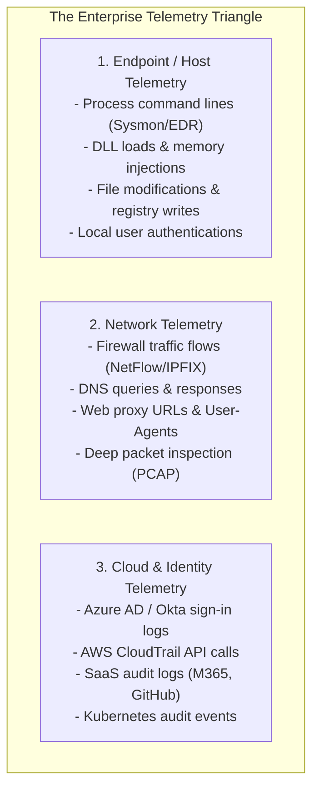

# 01. Security Monitoring and Telemetry

[⬅️ Back to Core Concepts](./README.md) | [Next: Logs and Event Analysis ➡️](./02_Logs_Log_Sources_and_Event_Analysis.md)

---

### 1. Definition and Purpose

**Security Telemetry** refers to the automated collection and transmission of raw measurement data, state indicators, event logs, and forensic artifacts from distributed IT assets to a centralized monitoring system.

Without telemetry, a SOC analyst is attempting to solve a crime in a dark room with no cameras, no witnesses, and no fingerprints.

---

### 2. The Three Telemetry Pillars

---

### 3. Endpoint Telemetry: The Power of Microsoft Sysmon

While default Windows event logging is sparse, **Sysmon (System Monitor)** is a free Windows service from Sysinternals that captures granular, high-fidelity security telemetry:

| Sysmon Event ID | Description | What It Catches |
| :--- | :--- | :--- |
| **Event 1** | Process Creation | Full command line flags, process hashes (SHA256), parent process. |
| **Event 3** | Network Connection | Outbound IP and port initiated by a specific process (`curl.exe` reaching Russia). |
| **Event 7** | Image Loaded | DLL injection and sideloading. |
| **Event 11** | FileCreate | Dropped malware payloads, ransomware creating `.locked` files. |
| **Event 13** | RegistryEvent | Persistence created in `CurrentVersion\Run` keys. |
| **Event 22** | DNSEvent | Specific domain queried by an individual process. |
