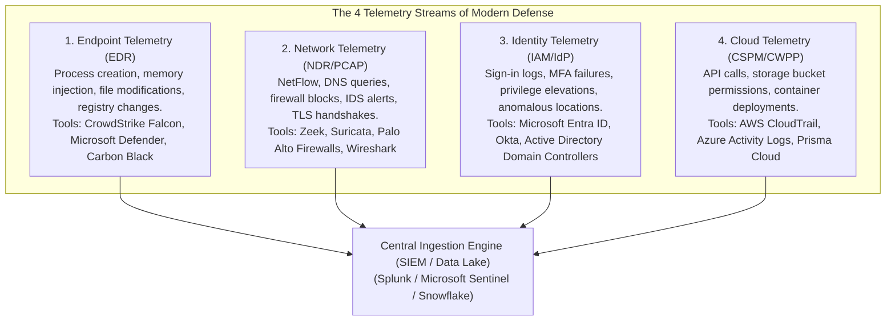
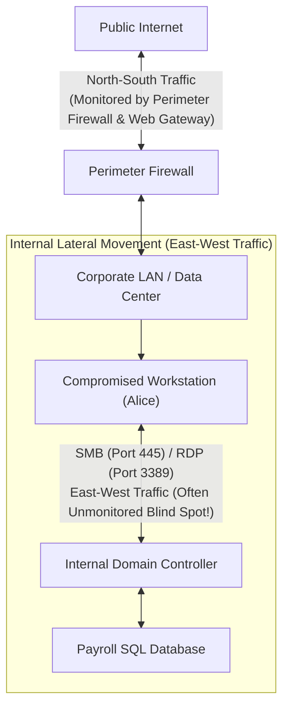

# 01. Security Monitoring and Telemetry

[⬅️ Back to Core Concepts](./README.md) | [Next: Logs and Event Analysis ➡️](./02_Logs_Log_Sources_and_Event_Analysis.md)

---

### 🎓 Beginner's Compass: Decoded Acronyms & Terms
- **Telemetry**: Continuous automated measurement and transmission of digital data from remote sources (computers, routers, cloud apps) to a central monitoring system.
- **Signal-to-Noise Ratio**: The proportion of meaningful, actionable security alerts (signals) compared to harmless background junk notifications (noise).
- **East-West Traffic**: Network communication moving laterally between servers inside the corporate data center.
- **North-South Traffic**: Network communication entering or exiting the corporate perimeter to/from the public internet.
- **Blind Spot**: Any computer, network subnet, or cloud service where security logs or EDR sensors are missing, leaving defenders blind to attacks.

---

### 1. Plain-English Walkthrough: The 4 Streams of Telemetry

To defend an enterprise, a SOC analyst cannot look at only one screen. Telemetry must be collected across **four distinct streams**:

---

### 2. North-South vs. East-West Traffic Monitoring

A classic mistake made by immature organizations is monitoring only the internet border:

* **North-South**: Traffic moving between the inside network and the outside internet (e.g., an employee visiting a website or malware downloading an update).
* **East-West**: Traffic moving between computers inside the same corporate network. When ransomware infects one laptop, it spreads East-West across file shares and domain controllers.

---

### 3. The Problem of Alert Fatigue

A large enterprise generates **billions of events every single day**:
- 50,000 laptops × 10,000 events/day = 500,000,000 raw events!
- If every event generated a notification, the SOC team would quit on day one.
- **Correlation Rules**: The SIEM filters raw telemetry using intelligent logic:
  - *“IF an employee fails password authentication 10 times in 2 minutes (Signal 1) AND succeeds on the 11th try (Signal 2) AND immediately spawns PowerShell from Word (Signal 3), THEN generate an urgent High-Priority Alert!”*

---

### 4. Common Beginner Mistakes vs. Best Practices

| Common Beginner Mistake | Real-World Risk | Industry Best Practice |
| :--- | :--- | :--- |
| **Assuming Firewalls see everything** | Firewalls inspect packet headers, but cannot see what encrypted malware is doing inside a computer's RAM. | Pair network monitoring with **Endpoint Detection and Response (EDR)** on all hosts. |
| **Ignoring DNS Telemetry** | Attackers use DNS queries for command-and-control beaconing and data exfiltration. | Ingest all internal recursive DNS logs into the SIEM and run entropy/domain length detections. |
| **Turning on all alerts simultaneously** | Enabling 400 default out-of-the-box detection rules floods analysts with thousands of false alerts daily (Alert Fatigue). | Baseline normal network behavior first; tune rules in **audit/report-only mode** before making them active. |

---

### 5. Recommended Next Steps
Learn how raw events are formatted, structured, and normalized into clean records:
- [02. Logs, Log Sources, and Event Analysis ➡️](./02_Logs_Log_Sources_and_Event_Analysis.md)
