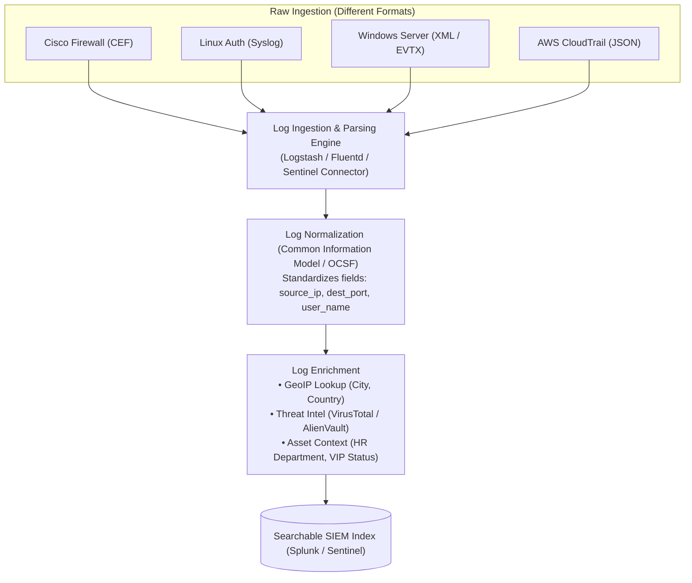

# 02. Logs, Log Sources, and Event Analysis

[⬅️ Prev: Security Monitoring & Telemetry](./01_Security_Monitoring_and_Telemetry.md) | [Back to Core Concepts](./README.md) | [Next: Cyber Kill Chain ➡️](./03_Cyber_Kill_Chain_and_Unified_Kill_Chain.md)

---

### 🎓 Beginner's Compass: Decoded Acronyms & Terms
- **Log**: A timestamped, immutable digital diary entry generated by software describing something that just occurred.
- **Syslog**: The standard protocol (RFC 5424) used by Linux systems, firewalls, and network routers to transmit logs over UDP/TCP Port 514.
- **CEF (Common Event Format)**: A standardized, tab/pipe-delimited logging format invented by ArcSight, widely used across network appliances.
- **Log Parsing**: The process of breaking a raw text log string into discrete, searchable database fields (e.g., separating `src_ip`, `dst_ip`, `user`, and `status`).
- **Log Normalization**: Translating different log formats into a single universal schema (e.g., mapping Cisco's `srcAddr`, Windows `IpAddress`, and Linux `from_ip` all to `source_ip`).
- **Enrichment**: Automatically adding valuable intelligence to a raw log as it arrives (e.g., adding GeoIP location, user department, or threat reputation).

---

### 1. Plain-English Walkthrough: The Tower of Babel Problem

Imagine a room with 10 people shouting in 10 different languages:
- A Cisco firewall speaks **CEF**: `CEF:0|Cisco|ASA|...|src=192.168.1.100|dst=10.0.0.1|`
- A Linux web server speaks **Apache Combined Log**: `192.168.1.100 - - [21/Nov/2026:10:00:00] "GET /login HTTP/1.1" 200 452`
- A Windows Server speaks **XML**: `<Event xmlns="..."><Data Name="IpAddress">192.168.1.100</Data></Event>`

If a SOC analyst wants to search: *"Show me all traffic from IP 192.168.1.100"*, they would have to write 10 different search queries.  
**Log Parsing and Normalization** solves this: it converts all 10 formats into a unified JSON format where the field is always `source_ip`.



---

### 2. Anatomy of a Structured Security Log

Here is a modern normalized security event in JSON format (such as an AWS CloudTrail or Sentinel event):

```json
{
  "timestamp": "2026-11-21T10:15:30Z",
  "event_type": "authentication",
  "action": "logon_attempt",
  "status": "failure",
  "reason": "invalid_credentials",
  "user": {
    "name": "charlie_finance",
    "department": "Accounts_Payable",
    "is_privileged": false
  },
  "source": {
    "ip": "185.220.101.5",
    "geo": {
      "country": "Germany",
      "city": "Frankfurt"
    },
    "threat_intel": {
      "is_known_tor_exit_node": true,
      "abuse_confidence_score": 98
    }
  },
  "target": {
    "app": "Microsoft_365_Exchange",
    "protocol": "HTTPS",
    "port": 443
  }
}
```

Notice the **threat intelligence enrichment**: the SIEM automatically flagged that the incoming IP is a known Tor exit node with an AbuseIPDB score of 98%!

---

### 3. Common Beginner Mistakes vs. Best Practices

| Common Beginner Mistake | Real-World Risk | Industry Best Practice |
| :--- | :--- | :--- |
| **Using Unencrypted Syslog (UDP 514)** | UDP packets can be dropped during network spikes, and unencrypted logs can be spoofed or sniffed by attackers. | Enforce **TLS-encrypted Syslog (TCP 6514)** for all remote log shippers. |
| **Storing Logs in Local Timezones** | Servers in London, Tokyo, and New York logging in local time make incident timelines impossible to reconstruct. | Mandate **UTC (Coordinated Universal Time)** across all enterprise servers and network appliances. |
| **Short Retention Periods** | Retaining logs for only 14 days means when a breach is discovered 3 months later, all historical evidence is gone. | Retain hot/searchable logs for 90 days, and archive cold compressed logs in low-cost storage (e.g., AWS S3 Glacier) for **365+ days**. |

---

### 4. Recommended Next Steps
Discover how adversaries execute multi-stage attacks and how defenders disrupt them:
- [03. Cyber Kill Chain and Unified Kill Chain ➡️](./03_Cyber_Kill_Chain_and_Unified_Kill_Chain.md)
