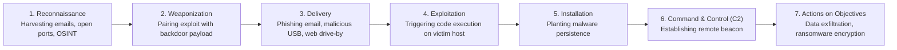

# 03. The Cyber Kill Chain and Unified Kill Chain

[⬅️ Prev: Logs & Event Analysis](./02_Logs_Log_Sources_and_Event_Analysis.md) | [Back to Core Concepts](./README.md) | [Next: MITRE ATT&CK ➡️](./04_MITRE_ATTACK_Framework_in_Practice.md)

---

### 1. The Lockheed Martin Cyber Kill Chain

Developed by Lockheed Martin in 2011, the **Cyber Kill Chain** is a military-derived model outlining the 7 sequential stages an adversary must execute to achieve their objective:

> 💡 **The Defender's Golden Rule**: **"Break any link in the chain, and the attack fails."**
> If an attacker successfully executes steps 1 through 5, but our egress firewall blocks their Command & Control beacon (Step 6), they cannot receive commands or steal data. The attack is thwarted.

---

### 2. Defensive Countermeasures Across the Chain

| Kill Chain Phase | Attacker Action | SOC Defensive Capability |
| :--- | :--- | :--- |
| **Reconnaissance** | Port scanning corporate perimeter | Threat Intelligence, Shodan monitoring, external surface scanning. |
| **Weaponization** | Compiling malicious macro in Word | VirusTotal hunting, Yara rules, malware sandbox detonation. |
| **Delivery** | Sending spear-phishing email | Secure Email Gateway (Proofpoint), DMARC/SPF, URL rewriting. |
| **Exploitation** | User opens attachment; exploit executes | Endpoint Detection & Response (EDR), Antivirus, Memory protection. |
| **Installation** | Dropping payload into Startup folder | Sysmon Event 11 (FileCreate), registry run key monitoring. |
| **Command & Control** | Beaconing out to dynamic IP over HTTPS | DNS filtering (Cisco Umbrella), Web Proxy categorization, JA3 fingerprinting. |
| **Actions on Objectives**| Encrypting file shares with ransomware | EDR behavioral ransomware rollback, Canary files, Data Loss Prevention (DLP). |
