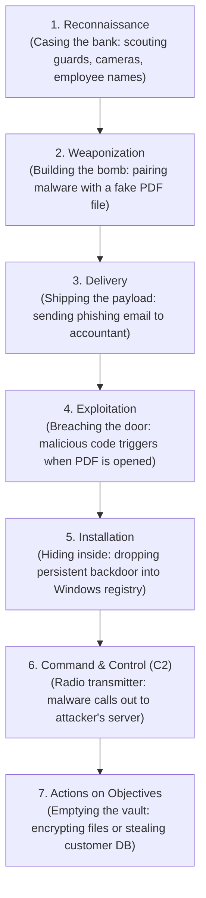

# 03. Cyber Kill Chain and Unified Kill Chain

[⬅️ Prev: Logs and Event Analysis](./02_Logs_Log_Sources_and_Event_Analysis.md) | [Back to Core Concepts](./README.md) | [Next: MITRE ATT&CK Framework ➡️](./04_MITRE_ATTACK_Framework_in_Practice.md)

---

### 🎓 Beginner's Compass: Decoded Acronyms & Terms
- **Cyber Kill Chain**: A cybersecurity framework developed by Lockheed Martin identifying the 7 chronological phases of an external cyberattack.
- **Weaponization**: The attacker pairing an exploit with a malicious delivery vehicle (e.g., embedding shellcode into a PDF invoice).
- **C2 (Command and Control)**: The secret communications channel between malware running inside the network and the attacker's internet server.
- **Actions on Objectives**: The final phase where the attacker accomplishes their true mission (stealing intellectual property, encrypting files with ransomware, or wiretapping emails).
- **Unified Kill Chain**: An expanded 18-phase model developed by Paul Pols that covers modern internal lateral movement, persistence, and cloud attacks.

---

### 1. Plain-English Walkthrough: The 7-Step Bank Heist Analogy

To steal money from a bank vault, criminals don't just magically appear inside the vault. They must execute a sequence of dependent steps. **If defenders break any single link in the chain, the entire attack fails!**

---

### 2. How the SOC Breaks Each Link of the Kill Chain

The primary goal of a SOC analyst is **early disruption**: the earlier you stop the attacker, the lower the business damage!

| Kill Chain Phase | Attacker Action | SOC Telemetry Source | Defensive Control / Disruption |
| :--- | :--- | :--- | :--- |
| **1. Reconnaissance** | Scanning external web servers and researching staff on LinkedIn | External Firewall / Web Gateway | Threat intelligence blocking, web application firewalls (WAF), hiding staff emails. |
| **2. Weaponization** | Embedding malicious macros into `.xlsm` spreadsheet | Threat Intel Feeds | YARA rules, threat intelligence sharing, sandbox testing. |
| **3. Delivery** | Phishing email sent to accounts payable team | Email Security Gateway (Proofpoint/Mimecast) | Email spam filters, SPF/DKIM/DMARC checks, quarantine attachments. |
| **4. Exploitation** | Victim opens attachment; buffer overflow triggers code | Endpoint Detection (EDR) | Microsoft Defender Exploit Guard, patching vulnerable software, disabling macros. |
| **5. Installation** | Malware creates scheduled task or Registry Run key | Sysmon / EDR Process Telemetry | Host isolation, blocking unapproved executables via AppLocker, killing rogue processes. |
| **6. Command & Control** | Malware initiates outbound HTTPS beacon to unknown Russian IP | Network Firewalls / Proxy / DNS | DNS Sinkholing, blocking C2 IP on perimeter firewall, revoking active sessions. |
| **7. Actions on Objectives** | Attacker begins encrypting database or exfiltrating data | SIEM / File Integrity Monitoring / DLP | Data Loss Prevention (DLP) blocks bulk uploads; offline immutable backups restore files. |

---

### 3. Common Beginner Mistakes vs. Best Practices

| Common Beginner Mistake | Real-World Risk | Industry Best Practice |
| :--- | :--- | :--- |
| **Waiting for Phase 7 (Impact)** | Waiting until files are being encrypted by ransomware before responding guarantees catastrophic downtime. | Focus detection engineering on **Phases 3, 4, and 5** (phishing, process injection, and persistence) to eradicate the intruder early. |
| **Treating Phishing as only a User Issue** | Blaming employees when they click phishing links ignores systemic technical defenses. | Enforce automated email sandboxing, attachment stripping, and phishing-resistant FIDO2 hardware MFA. |
| **Assuming the Attack Ends when Malware is Killed** | Killing the malware executable while the attacker still holds active stolen administrative credentials allows them to log back in minutes later. | Always perform full **credential resets** and **token revocations** alongside malware removal. |

---

### 4. Recommended Next Steps
Learn how the global cybersecurity industry categorizes attacker behaviors with the MITRE ATT&CK matrix:
- [04. MITRE ATT&CK Framework in Practice ➡️](./04_MITRE_ATTACK_Framework_in_Practice.md)
