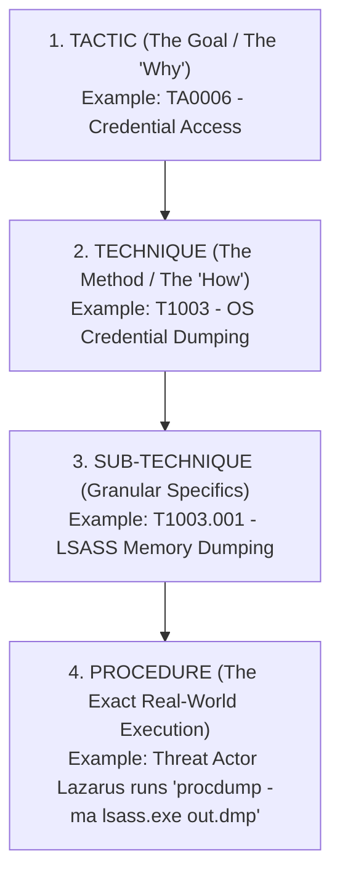

# 04. MITRE ATT&CK Framework in Practice

[⬅️ Prev: Cyber Kill Chain](./03_Cyber_Kill_Chain_and_Unified_Kill_Chain.md) | [Back to Core Concepts](./README.md) | [Next: Threat Intelligence and IOCs ➡️](./05_Threat_Intelligence_and_Indicators_of_Compromise.md)

---

### 🎓 Beginner's Compass: Decoded Acronyms & Terms
- **MITRE ATT&CK**: Stands for **Adversarial Tactics, Techniques, and Common Knowledge**. It is a publicly curated, globally authoritative knowledge base of real-world adversary behaviors.
- **Tactic (The "WHY")**: The attacker's tactical objective (e.g., *"I want to gain Initial Access"* or *"I want to steal credentials"*). There are 14 enterprise tactics.
- **Technique (The "HOW")**: The specific technical method used to accomplish the tactic (e.g., Technique `T1059: Command and Scripting Interpreter`).
- **Sub-Technique**: A granular breakdown of a technique (e.g., `T1059.001: PowerShell`).
- **Procedure (The "WHAT")**: The exact software, code, or commands used in a specific real-world attack (e.g., APT29 executing `powershell.exe -enc...`).
- **ATT&CK Navigator**: A free interactive web tool allowing defenders to visualize detection coverage across the entire matrix.

---

### 1. Plain-English Walkthrough: The FBI Criminal Modus Operandi

Before MITRE ATT&CK, cybersecurity reports were confusing:
- One vendor called an attack *"A credential harvest"*.
- Another vendor called it *"Password scraping"*.
- A third called it *"Memory dump attack"*.

MITRE standardized the entire industry like an **FBI behavioral catalog**:
* **Tactic (Goal)**: Credential Access (`TA0006`).
* **Technique (Method)**: OS Credential Dumping: LSASS Memory (`T1003.001`).
* **Procedure (Evidence)**: The attacker executed `mimikatz.exe privilege::debug sekurlsa::logonpasswords` on Domain Controller DC01.

---

### 2. The 14 Enterprise ATT&CK Tactics in Chronological Order

Adversaries generally progress from left to right across the matrix:

```mermaid
flowchart LR
    T1["1. Reconnaissance"] --> T2["2. Resource Dev"]
    T2 --> T3["3. Initial Access"]
    T3 --> T4["4. Execution"]
    T4 --> T5["5. Persistence"]
    T5 --> T6["6. Privilege Escalation"]
    T6 --> T7["7. Defense Evasion"]
    T7 --> T8["8. Credential Access"]
    T8 --> T9["9. Discovery"]
    T9 --> T10["10. Lateral Movement"]
    T10 --> T11["11. Collection"]
    T11 --> T12["12. Command & Control"]
    T12 --> T13["13. Exfiltration"]
    T13 --> T14["14. Impact"]
```

| Tactic ID | Tactic Name | What the Attacker is Trying to Do | Common Technique |
| :--- | :--- | :--- | :--- |
| **TA0001** | **Initial Access** | Get their foot inside the corporate network | `T1566: Phishing` |
| **TA0002** | **Execution** | Run malicious software or commands | `T1059: Command and Scripting Interpreter` |
| **TA0003** | **Persistence** | Maintain access across computer reboots | `T1547: Boot or Logon Autostart (Registry Run Keys)` |
| **TA0004** | **Privilege Escalation** | Elevate standard user access to Administrator or SYSTEM | `T1068: Exploitation for Privilege Escalation` |
| **TA0005** | **Defense Evasion** | Avoid being caught by antivirus or SOC alerts | `T1070: Indicator Removal (Clearing Event Logs)` |
| **TA0006** | **Credential Access** | Steal passwords, hashes, and session tokens | `T1003: OS Credential Dumping` |
| **TA0007** | **Discovery** | Look around to see what servers and users exist | `T1087: Account Discovery`, `T1046: Network Port Scan` |
| **TA0008** | **Lateral Movement** | Jump from workstation to server across internal network | `T1021: Remote Services (RDP / SMB)` |
| **TA0009** | **Collection** | Gather confidential documents, emails, and databases | `T1114: Email Collection`, `T1560: Archive Collected Data` |
| **TA0011** | **Command & Control** | Establish remote access connection back to hacker | `T1071: Application Layer Protocol (Web / HTTPS)` |
| **TA0010** | **Exfiltration** | Steal data out of corporate environment to the internet | `T1048: Exfiltration Over Alternative Protocol` |
| **TA0040** | **Impact** | Disrupt, destroy, or encrypt business operations | `T1486: Data Encrypted for Impact (Ransomware)` |

---

### 3. How a SOC Analyst Uses ATT&CK in Daily Triage

When reviewing an alert in Microsoft Sentinel or Splunk:
1. **Identify the Technique**: The alert says *"Suspicious scheduled task created on server DB01"*. You map this to **`T1053.005: Scheduled Task`** under Tactic **Persistence (`TA0003`)**.
2. **Anticipate Next Steps**: Because the attacker is establishing persistence, their next likely moves are **Privilege Escalation** or **Credential Access**.
3. **Hunt for Correlated Activity**: You search your logs for `mimikatz`, `lsass` memory dumping, or new local user creations within 30 minutes of that scheduled task!

---

### 4. Common Beginner Mistakes vs. Best Practices

| Common Beginner Mistake | Real-World Risk | Industry Best Practice |
| :--- | :--- | :--- |
| **Treating ATT&CK as a checklist** | Trying to build 500 detection rules for every single technique simultaneously results in an unmanageable alert storm. | Prioritize techniques used by threat actors actively targeting your industry (e.g., healthcare vs finance) using **CISA advisories**. |
| **Focusing only on Malware Techniques** | Ignoring techniques that use built-in Windows tools (`certutil.exe`, `wmic.exe`, `net.exe`) allows Living-off-the-Land attacks to succeed. | Build detections specifically focused on **LOLBAS (Living-off-the-Land Binaries and Scripts)**. |
| **Neglecting Procedure-level detection** | Writing a rule that only triggers on the exact word `mimikatz` allows attackers to bypass detection simply by renaming the `.exe`. | Detect the underlying behavioral procedure: detecting unauthorized read requests to `lsass.exe` memory (Sysmon Event 10). |

---

### 5. Recommended Next Steps
Learn how threat intelligence is gathered and categorized across the Pyramid of Pain:
- [05. Threat Intelligence and Indicators of Compromise ➡️](./05_Threat_Intelligence_and_Indicators_of_Compromise.md)
