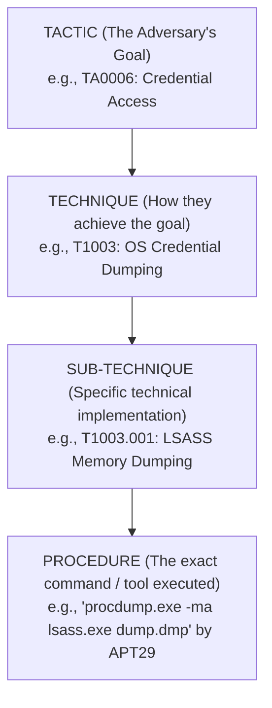

# 04. MITRE ATT&CK Framework in Practice

[⬅️ Prev: Cyber Kill Chain](./03_Cyber_Kill_Chain_and_Unified_Kill_Chain.md) | [Back to Core Concepts](./README.md) | [Next: Threat Intelligence & IOCs ➡️](./05_Threat_Intelligence_and_Indicators_of_Compromise.md)

---

### 1. What is MITRE ATT&CK?

**MITRE ATT&CK (Adversarial Tactics, Techniques, and Common Knowledge)** is a globally accessible, curated knowledge base of real-world adversary behavior based on actual observed cyber attacks.

While the Cyber Kill Chain describes the *linear phases* of an attack, MITRE ATT&CK provides the granular **matrix of technical mechanisms** an attacker uses at any moment.

---

### 2. The 14 Enterprise Tactics

1. **Reconnaissance**: Gathering information.
2. **Resource Development**: Buying infrastructure, staging servers.
3. **Initial Access**: Getting into the network (Phishing, Exploit public app).
4. **Execution**: Running malicious code (PowerShell, Scripting).
5. **Persistence**: Maintaining access across reboots (Scheduled tasks, Registry).
6. **Privilege Escalation**: Gaining higher permissions (SYSTEM, root, Domain Admin).
7. **Defense Evasion**: Avoiding detection (Disabling antivirus, Masquerading).
8. **Credential Access**: Stealing usernames and passwords (Dumping LSASS, Keylogging).
9. **Discovery**: Mapping the environment (Port scanning, querying AD groups).
10. **Lateral Movement**: Moving between computers (SMB, PsExec, SSH).
11. **Collection**: Gathering sensitive files for theft.
12. **Command and Control**: Communicating with outside servers.
13. **Exfiltration**: Stealing data out of the network.
14. **Impact**: Destroying or disrupting systems (Ransomware encryption, Disk wiping).

---

### 3. How a SOC Analyst Uses MITRE ATT&CK

- **Alert Categorization**: When an alert fires in Sentinel, it is tagged with `T1059.001 (PowerShell)`. The analyst instantly knows the adversary's tactic.
- **Hypothesis-Driven Hunting**: *"Do we have visibility into T1078 (Valid Accounts)? Let's hunt for unmanaged service accounts logging in from unusual subnets."*
- **Gap Analysis**: Security teams map their detection rules onto the ATT&CK Matrix heatmap. White/empty areas reveal blind spots in defensive logging.
