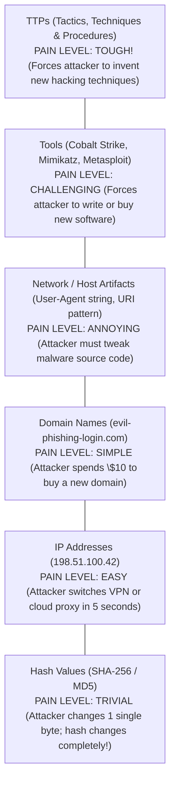

# 05. Threat Intelligence and Indicators of Compromise

[⬅️ Prev: MITRE ATT&CK Framework](./04_MITRE_ATTACK_Framework_in_Practice.md) | [Back to Core Concepts](./README.md) | [Next: Vulnerability Management vs IR ➡️](./06_Vulnerability_Management_vs_Incident_Response.md)

---

### 🎓 Beginner's Compass: Decoded Acronyms & Terms
- **CTI (Cyber Threat Intelligence)**: Evidence-based knowledge (mechanisms, indicators, context) about threats that can be used to inform defensive security decisions.
- **IOC (Indicator of Compromise)**: Forensic breadcrumbs left behind by an attacker (file hashes, IP addresses, domains).
- **IOA (Indicator of Attack)**: Proactive signs of an attack happening in real time, focusing on *intent* rather than static signatures.
- **The Pyramid of Pain**: A famous cybersecurity model created by David Bianco illustrating how difficult it is for an attacker to change different types of indicators when defenders block them.
- **STIX / TAXII**: Open standardized formats and transport protocols for sharing automated cyber threat intelligence between security tools.
- **OSINT**: Open Source Intelligence gathered from public search engines, dark web forums, and threat platforms (VirusTotal, AbuseIPDB, Shodan).

---

### 1. The Pyramid of Pain (David Bianco)

The Pyramid of Pain is one of the most famous models in cybersecurity. It answers:  
*"If we block this indicator, how much pain does it cause the hacker?"*

| Indicator Level | Why It Is Painful / Trivial for Attackers | Real-World Example |
| :--- | :--- | :--- |
| **1. Hash Values** | **TRIVIAL**: An attacker modifies one invisible character in their malware code, re-compiles it, and gets a completely new hash in 2 seconds. | `e3b0c44298fc1c149afbf4c8996fb92427ae41e4649b934ca495991b7852b855` |
| **2. IP Addresses** | **EASY**: Attackers route traffic through millions of commercial VPNs, Tor exit nodes, or hijacked home routers (botnets). | `185.220.101.5` |
| **3. Domain Names** | **SIMPLE**: Attackers use Domain Generation Algorithms (DGA) to register thousands of cheap throwaway domains daily. | `update-windows-security-service.com` |
| **4. Network / Host Artifacts** | **ANNOYING**: Signature patterns in HTTP headers (e.g., custom user agents) or registry values. Attacker must reconfigure their dropper. | Malicious C2 User-Agent: `Mozilla/5.0 (compatible; EvilBot/1.0)` |
| **5. Tools** | **CHALLENGING**: Blocking the attacker's primary software framework (e.g., Cobalt Strike or Mimikatz) forces them to re-engineer custom tools. | Detecting standard Cobalt Strike default named pipes (`\\.\pipe\msagent_01`). |
| **6. TTPs** | **TOUGH**: Changing their fundamental behavior (e.g., how they escalate privileges or dump passwords) requires re-training entire military hacking units. | Detecting the underlying behavior: detecting when *any* process attempts to read `lsass.exe` memory. |

---

### 2. IOCs vs. IOAs: The Crucial Difference

| Feature | Indicator of Compromise (IOC) | Indicator of Attack (IOA) |
| :--- | :--- | :--- |
| **Nature** | **Reactive & Static**: Clues from the past. | **Proactive & Dynamic**: Behaviors occurring right now. |
| **Real-World Analogy** | Fingerprints left at a crime scene after the bank robbery. | A person wearing a disguise sneaking around the bank roof with a blowtorch. |
| **Detection Mechanism** | Matching file hashes or known malicious IPs. | Detecting process injection, living-off-the-land commands, and unusual child processes. |
| **Effectiveness Against Zero-Days** | **Zero**: Useless against brand-new, never-before-seen malware. | **High**: Catches novel malware because the *behavior* (e.g., disabling antivirus) is inherently suspicious. |

---

### 3. Free OSINT Tools Every Analyst Uses Daily

1. **VirusTotal**: Submitting file hashes, domains, and IPs to be scanned by 70+ antivirus engines simultaneously.
2. **AbuseIPDB**: Checking if an IP address has been reported by other administrators for brute-force attacks or port scanning within the last 24 hours.
3. **URLhaus / Any.Run**: Detonating suspicious links and viewing live interactive behavioral recordings in an isolated sandbox.
4. **Shodan**: Search engine that scans the entire internet to show open ports, running services, and exposed webcams/databases.

---

### 4. Common Beginner Mistakes vs. Best Practices

| Common Beginner Mistake | Real-World Risk | Industry Best Practice |
| :--- | :--- | :--- |
| **Relying 100% on Hash Lookups** | If a file hash has 0 detections on VirusTotal, assuming it is safe allows targeted custom malware to run unrestricted. | Always perform **dynamic behavioral analysis**; inspect what the file actually does when executed. |
| **Uploading Confidential Files to VirusTotal** | Uploading proprietary corporate spreadsheets or customer databases to public VirusTotal makes confidential data publicly downloadable! | Only submit **File Hashes** (SHA-256) to public platforms; detonate proprietary files in private internal sandboxes. |
| **Blocking IPs Indefinitely** | Adding an IP to a permanent firewall blocklist when attackers frequently abandon IP addresses after 24 hours leads to bloated firewalls and blocked benign CDNs. | Set **time-to-live (TTL)** expirations on threat intelligence IP blocks (e.g., expire after 30 to 90 days). |

---

### 5. Recommended Next Steps
Understand the boundary between proactive vulnerability scanning and reactive incident response:
- [06. Vulnerability Management vs Incident Response ➡️](./06_Vulnerability_Management_vs_Incident_Response.md)
