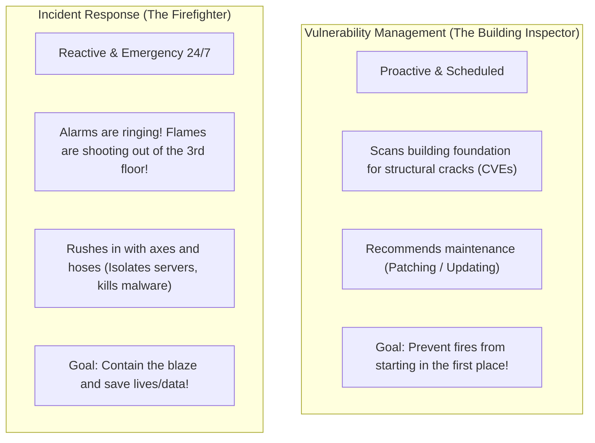

# 06. Vulnerability Management vs. Incident Response

[⬅️ Prev: Threat Intelligence and IOCs](./05_Threat_Intelligence_and_Indicators_of_Compromise.md) | [Back to Core Concepts](./README.md) | [Next: Technologies & Architectures Track ➡️](../03_Technologies_and_Architectures/README.md)

---

### 🎓 Beginner's Compass: Decoded Acronyms & Terms
- **Vulnerability**: A software flaw, design weakness, or misconfiguration that can be exploited by an attacker (e.g., an unpatched bug in Apache).
- **Exploit**: A piece of software, script, or sequence of commands that takes advantage of a vulnerability to cause unintended behavior (e.g., gaining remote shell access).
- **CVE (Common Vulnerabilities and Exposures)**: A globally unique tracking identifier assigned to a publicly known cybersecurity flaw (e.g., `CVE-2021-44228`).
- **CVSS (Common Vulnerability Scoring System)**: The standard numerical scoring framework (from `0.0` to `10.0`) evaluating the severity of a vulnerability.
- **Zero-Day (0-Day)**: A vulnerability that is actively known and exploited in the wild before the software developer has released a security patch.
- **CISA KEV**: The Cybersecurity and Infrastructure Security Agency's catalog of **Known Exploited Vulnerabilities**—the definitive list of bugs actively being used by hackers in the wild right now.

---

### 1. Plain-English Walkthrough: The Building Inspector vs. The Firefighter

Beginners often confuse **Vulnerability Management (VM)** with **Incident Response (IR)**:



---

### 2. The CVSS v3.1 Scoring System Explained

A CVSS score ranges from `0.0` to `10.0`. It is calculated across **Base Metrics**:

| Metric | Options & Severity Impact |
| :--- | :--- |
| **Attack Vector (AV)** | **Network** (Worst: exploitable over internet) > Adjacent > Local > Physical. |
| **Attack Complexity (AC)** | **Low** (Worst: simple automated script) vs High (requires complex conditions). |
| **Privileges Required (PR)** | **None** (Worst: unauthenticated stranger) > Low (standard user) > High (admin). |
| **User Interaction (UI)** | **None** (Worst: zero clicks needed) vs Required (victim must click link). |
| **Scope (S)** | **Changed** (Worst: exploiting web server grants control of the whole cloud). |
| **Impact (CIA)** | Impact on **Confidentiality**, **Integrity**, and **Availability** (None, Low, High). |

#### The CVSS Severity Tiers:
* **0.0**: None
* **0.1 - 3.9**: Low
* **4.0 - 6.9**: Medium
* **7.0 - 8.9**: High
* **9.0 - 10.0**: **CRITICAL** (e.g., Log4Shell, EternalBlue: Remote code execution over the internet with zero credentials and zero user interaction!).

---

### 3. Vulnerability Prioritization: Why CVSS 10 is Not Always Priority #1

In real-world enterprises, IT teams cannot patch 10,000 vulnerabilities simultaneously. You must prioritize based on **Exposure and Active Exploitation**:

```mermaid
flowchart TD
    Vuln["Discovered Vulnerability"] --> IsInternetExposed{Is it exposed to the public internet?}
    IsInternetExposed -->|Yes| CheckKEV{Is it listed in CISA KEV (Actively Exploited)?}
    IsInternetExposed -->|No| Internal["Lower Priority: Internal server behind 3 firewalls (SLA: 30 days)"]
    
    CheckKEV -->|Yes| Urgent["EMERGENCY P0 PRIORITY!<br/>Patch or mitigate within 24 - 48 hours!"]
    CheckKEV -->|No| High["High Priority: Publicly accessible but no active in-the-wild exploit (SLA: 7 days)"]
```

---

### 4. Common Beginner Mistakes vs. Best Practices

| Common Beginner Mistake | Real-World Risk | Industry Best Practice |
| :--- | :--- | :--- |
| **Patching only CVSS 9.0+** | Threat actors frequently chain two CVSS 6.0 bugs (e.g., an unauthenticated info disclosure + local privilege escalation) to achieve full system takeover. | Prioritize by **Exploitability (CISA KEV)** and business asset criticality rather than CVSS score alone. |
| **Scanning production without permission** | Running intensive vulnerability scans during peak business hours can crash legacy industrial or medical databases. | Schedule active network scans during designated maintenance windows; coordinate with database administrators. |
| **Confusing scanning with compliance** | Handing an auditor a 2,000-page Nessus vulnerability scan report does not prove security; it only proves you have vulnerabilities! | Demonstrate a closed-loop remediation process: show how discovered vulnerabilities were patched, verified, and re-scanned. |

---

### 5. Recommended Next Steps
Now that you have mastered the Core Concepts, explore the core architectures and technologies powering modern SOC detection:
- [03. Technologies & Architectures: SIEM Architecture Deep Dive ➡️](../03_Technologies_and_Architectures/01_SIEM_Architecture_and_Data_Ingestion.md)
