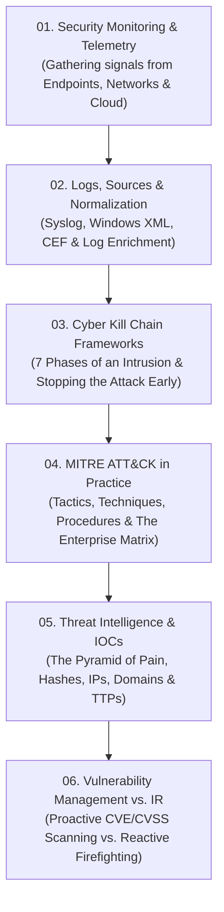

# 02. SOC Core Concepts Track

Welcome to the **SOC Core Concepts** track. In this module, we transition from operating system and network basics into the analytical frameworks, telemetry streams, and threat models used by professional security analysts to detect and track adversaries.

---

### 🗺️ Module Learning Pathway

---

### 📚 Topics in This Module

| Document | Primary Focus | Everyday Analogy |
| :--- | :--- | :--- |
| **[01. Security Monitoring & Telemetry](./01_Security_Monitoring_and_Telemetry.md)** | Collecting data across endpoints, network, and cloud | The security cameras, motion sensors, and door sensors of a building |
| **[02. Logs & Event Analysis](./02_Logs_Log_Sources_and_Event_Analysis.md)** | Formatting, parsing, and normalizing raw event logs | Translating 20 foreign languages into one universal airport bulletin board |
| **[03. Cyber Kill Chain](./03_Cyber_Kill_Chain_and_Unified_Kill_Chain.md)** | The 7 chronological steps of a cyberattack | The bank heist timeline: Casing the bank to drilling the vault |
| **[04. MITRE ATT&CK Framework](./04_MITRE_ATTACK_Framework_in_Practice.md)** | Mapping attacker behaviors to standard techniques | The FBI criminal behavior taxonomy and known robber habits |
| **[05. Threat Intelligence & IOCs](./05_Threat_Intelligence_and_Indicators_of_Compromise.md)** | The Pyramid of Pain and actionable indicators | Fingerprints and license plates vs understanding the robber's mastermind plan |
| **[06. Vulnerability Mgmt vs. IR](./06_Vulnerability_Management_vs_Incident_Response.md)** | CVEs, CVSS scores, and proactive vs reactive security | Inspecting the building foundation for cracks vs calling firefighters |
