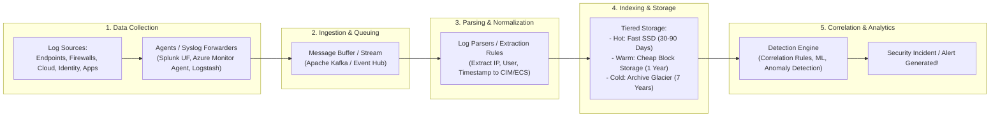

# 01. SIEM Architecture and Data Ingestion Pipelines

[⬅️ Back to Technologies](./README.md) | [Next: EDR and XDR Mechanisms ➡️](./02_EDR_and_XDR_Mechanisms.md)

---

### 1. Definition and Purpose

A **Security Information and Event Management (SIEM)** platform is the central nervous system of a SOC. It aggregates, normalizes, indexes, and correlates billions of security events from disparate enterprise systems to detect complex attacks in real time and maintain compliance records.

> 💡 **Analogy**: The Airport Air Traffic Control Tower:
> - Radars, weather sensors, pilot radio chatter, runway cameras, and transponders stream raw data continuously from 50 different vendors.
> - An air traffic controller cannot look at 100 individual radar screens.
> - The central tower software aggregates and correlates all feeds onto a single master display, automatically highlighting if two airplanes are on a collision course.
> A **SIEM** performs this exact function for corporate security.

---

### 2. SIEM Architectural Pipeline



---

### 3. How Correlation Rules Work

A **Correlation Rule** looks across multiple independent log sources over a defined time window to detect an attack pattern that would be invisible in a single log:

```text
CORRELATION RULE LOGIC:
IF (5 or more Event ID 4625 "Failed Windows Logon" occur for User X within 2 minutes)
AND THEN (Event ID 4624 "Successful Windows Logon" occurs for User X from the same Source IP within 5 minutes)
AND THEN (Outbound Firewall Connection initiated to an IP with Reputation Score < 20)
THEN GENERATE HIGH-SEVERITY ALERT: "Brute-Force Attack Followed by Successful Compromise & C2 Outbound"
```
