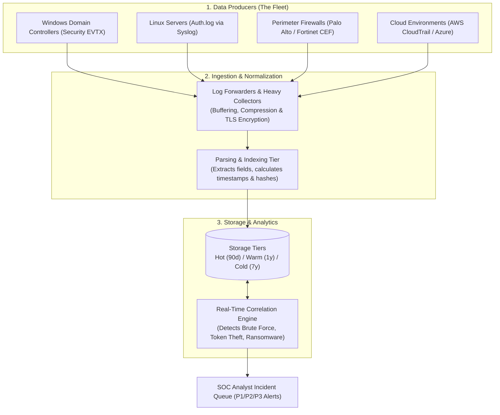
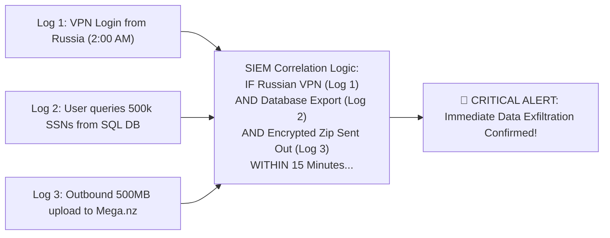

# 01. SIEM Architecture and Data Ingestion

[⬅️ Back to Technologies](./README.md) | [Next: EDR and XDR Mechanisms ➡️](./02_EDR_and_XDR_Mechanisms.md)

---

### 🎓 Beginner's Compass: Decoded Acronyms & Terms
- **SIEM (Security Information and Event Management)**: The central data repository that aggregates, correlates, analyzes, and retains logs from every computer, server, and firewall across the entire company.
- **Forwarder / Agent**: A lightweight software client installed on servers that collects local logs and ships them to the SIEM (e.g., Splunk Universal Forwarder, Azure Monitor Agent).
- **Correlation Rule**: An automated mathematical query running every 5 minutes that searches for patterns across different log sources to trigger alerts.
- **Storage Tiers (Hot / Warm / Cold)**:
  - **Hot**: Blazing fast, expensive SSD storage for instant searches (last 30–90 days).
  - **Warm**: Slower, compressed storage for historical investigations (90–365 days).
  - **Cold**: Ultra-cheap archive storage (e.g., AWS S3 Glacier) for legal compliance (1–7 years).
- **Ingestion Volume (GB/day or EPS)**: The speed at which logs enter the SIEM, measured in Gigabytes per day or **Events Per Second (EPS)**.

---

### 1. Plain-English Walkthrough: The Airport Air Traffic Control Tower

Imagine an international airport with 500 airplanes flying overhead, 100 baggage carts moving on the tarmac, and 50 fueling trucks:
- If each vehicle operated independently without talking to anyone, planes would collide on runways constantly!
- The **Air Traffic Control Tower** is the **SIEM**:
  - Every pilot transmits their radar altitude, speed, and heading to the tower.
  - The tower's computers correlate the flight paths.
  - If Plane A and Plane B are on a collision course, the alarm sounds instantly!
- In IT security, the SIEM collects firewalls, VPNs, Windows servers, and cloud databases into **one unified command screen**.

---

### 2. How Correlation Rules Work in Practice

A correlation rule combines multiple benign logs into a **single high-fidelity security alert**:

---

### 3. Common Beginner Mistakes vs. Best Practices

| Common Beginner Mistake | Real-World Risk | Industry Best Practice |
| :--- | :--- | :--- |
| **Ingesting Everything Blindly** | Ingesting noisy debug logs (e.g., successful web server image requests) costs hundreds of thousands of dollars in SIEM license fees without providing security value. | Filter logs **at the source/forwarder level**: drop noisy, low-value events before they hit the SIEM billing meter. |
| **Ignoring Ingestion Lag** | If forwarder network buffers are jammed, logs arrive 3 hours late, meaning the SOC investigates attacks 3 hours after they already succeeded. | Configure **Ingestion Latency Health Alerts** in your SIEM to notify engineers if log arrival delay exceeds 10 minutes. |
| **Writing Broad, Unoptimized Queries** | Running wildcards (`*mimikatz*`) across 50 Terabytes of un-indexed data freezes the SIEM for other analysts. | Always scope searches by **Time Range**, **Index**, and specific fields (e.g., `index=windows EventCode=4688 Image="*mimikatz.exe"`). |

---

### 4. Recommended Next Steps
Learn how endpoint sensors watch running processes and isolate infected workstations:
- [02. EDR and XDR Mechanisms ➡️](./02_EDR_and_XDR_Mechanisms.md)
