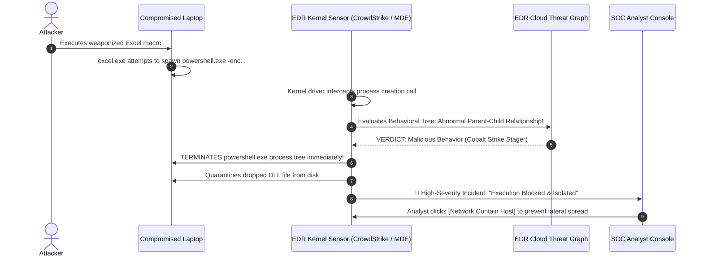
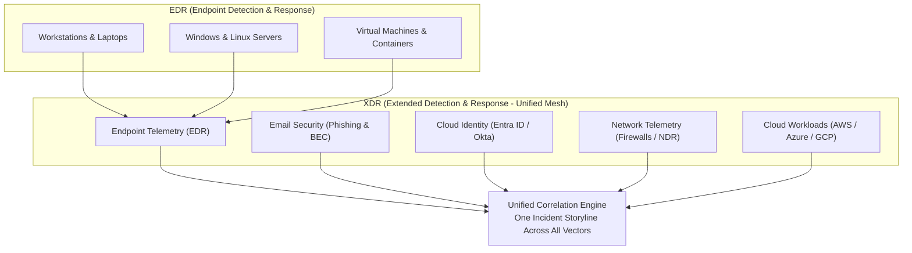

# 02. EDR and XDR Mechanisms

[⬅️ Prev: SIEM Architecture](./01_SIEM_Architecture_and_Data_Ingestion.md) | [Back to Technologies](./README.md) | [Next: Network Security and PCAP ➡️](./03_Network_Security_IDS_IPS_Firewalls_and_PCAP.md)

---

### 🎓 Beginner's Compass: Decoded Acronyms & Terms
- **EDR (Endpoint Detection and Response)**: Next-generation endpoint software (e.g., CrowdStrike Falcon, Microsoft Defender for Endpoint) operating at the operating system kernel level to monitor process behaviors, memory, and disk changes in real time.
- **XDR (Extended Detection and Response)**: The evolution of EDR that natively integrates endpoint telemetry with email security, network firewalls, and cloud identity into one unified attack timeline.
- **Kernel-Level Sensor**: Software running in Ring 0 (the highest privilege level of the operating system), allowing it to inspect and block malicious code before that code can tamper with the security agent.
- **Host Isolation (Network Quarantine)**: An emergency EDR feature that instantly severs a computer's network connectivity except for a secure encrypted tunnel to the SOC console.
- **Live Response / RTR (Real-Time Response)**: An interactive command-line console inside the EDR platform that lets analysts remotely browse files, kill processes, and extract memory from an infected laptop across the internet.

---

### 1. Plain-English Walkthrough: The Security Camera vs. The Armed Guard

#### Traditional Antivirus (The Old Way)
Think of traditional antivirus like a **security guard holding a binder of 500 wanted mugshots**:
- When someone enters the building, the guard flips through the binder.
- If the visitor's face matches Mugshot #42 (a known file hash or signature), the guard stops them.
- If a criminal puts on a pair of sunglasses and a fake mustache (alters one byte of malware), the guard smiles and lets them right through!

#### Modern EDR (The Behavior-Based Guard)
EDR doesn't care what the visitor looks like. **EDR watches what they DO**:
- If someone in a three-piece business suit starts picking the lock on the accounting door, cuts the security camera wires, and takes a sledgehammer to the drywall:
- **EDR tackles them immediately!**
- EDR detects malicious *behavior* (e.g., an Office document spawning PowerShell to inject code into memory), even if the malware was compiled 5 minutes ago and has never been seen before in history.

---

### 2. The Power of Host Isolation

When a ransomware infection or live hacker is spotted on an internal laptop, every second counts.
* Without EDR, an analyst has to call the user, ask them to find their Wi-Fi switch, or find the physical network cable in the office closet.
* **With EDR Network Isolation**:
  * With **one click in the cloud console**, the EDR agent tells the operating system's local firewall to drop 100% of incoming and outgoing network packets.
  * The hacker's remote shell **dies instantly**.
  * The malware cannot talk to the internal domain controller or encrypt shared drives.
  * **Crucially**: The laptop maintains a private, encrypted tunnel to the SOC console so the analyst can remotely investigate and clean the machine!

---

### 3. EDR vs. XDR: What is the Difference?

---

### 4. Common Beginner Mistakes vs. Best Practices

| Common Beginner Mistake | Real-World Risk | Industry Best Practice |
| :--- | :--- | :--- |
| **Leaving EDR in "Audit / Detection-Only" Mode** | The EDR logs the ransomware execution on your dashboard, but doesn't block it, allowing the entire hard drive to be encrypted! | Enforce **Automated Remediation / Block Mode** in production policies. |
| **Exempting Developer Folders from EDR** | Developers requesting broad folder exclusions (e.g., exclude `C:\Projects\`) creates a massive blind spot where attackers drop malware to evade detection. | Avoid blanket folder exclusions; use granular **certificate-based or binary-hash signing rules**. |
| **Rebooting an infected machine immediately** | Rebooting an infected laptop destroys precious volatile RAM memory where advanced malware (fileless attacks) resides. | **Isolate the host first**, take a remote memory dump via Live Response, and then proceed with remediation. |

---

### 5. Recommended Next Steps
Learn how network firewalls, IDS/IPS sensors, and packet captures inspect traffic over the wire:
- [03. Network Security: IDS, IPS, Firewalls, and PCAP Deep Dive ➡️](./03_Network_Security_IDS_IPS_Firewalls_and_PCAP.md)
