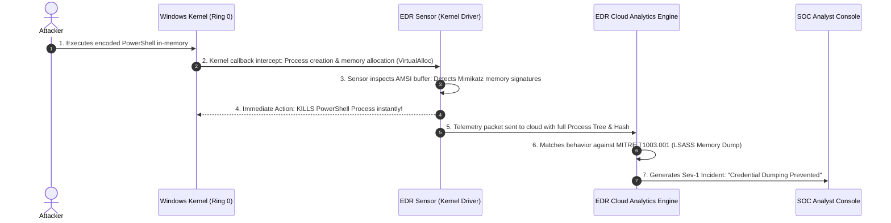

# 02. EDR and XDR Mechanisms

[⬅️ Prev: SIEM Architecture](./01_SIEM_Architecture_and_Data_Ingestion.md) | [Back to Technologies](./README.md) | [Next: Network Security & PCAP ➡️](./03_Network_Security_IDS_IPS_Firewalls_and_PCAP.md)

---

### 1. Conceptual Evolution: Antivirus to EDR to XDR

```
[LEGACY]
  Traditional Antivirus (AV)
  - Scans files at rest.
  - Relies on static signature matching (MD5/SHA256).
  - Easily bypassed by changing 1 byte of malware code or in-memory attacks.
      │
      ▼
  Endpoint Detection & Response (EDR)
  - Continuously records process executions, registry changes, network sockets, memory calls.
  - Detects BEHAVIOR (e.g., PowerShell injecting code into explorer.exe).
  - Provides active containment (network isolation, process termination, remote shell).
      │
      ▼
  Extended Detection & Response (XDR)
  - Unifies EDR with Identity (Entra ID), Email (M365 Defender), Cloud (AWS/Azure), and Network telemetry.
  - Automatically correlates cross-domain attacks into a single incident entity.
[MODERN]
```

---

### 2. How EDR Works Under the Hood

An EDR agent (like CrowdStrike Falcon Sensor or Microsoft Defender for Endpoint) operates at the **Operating System Kernel Level** (Ring 0 on Windows via kernel drivers or eBPF on Linux):



---

### 3. Key EDR Capabilities Every Analyst Uses

- **Host Network Isolation**: Cuts off all IP communications on the victim machine except for the management channel back to the EDR cloud. Stops ransomware from spreading across SMB shares.
- **Live Response / Remote Shell**: Provides an interactive administrative terminal to forensic analysts to inspect memory, list open handles, and pull volatile artifacts without alerting the user.
- **Process Lineage Tree**: Visually graphs who spawned what (e.g., `outlook.exe ➔ winword.exe ➔ cmd.exe ➔ powershell.exe`).
