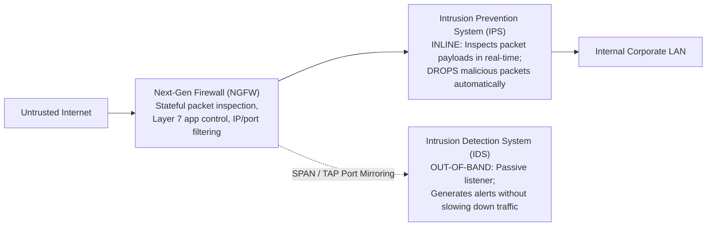

# 03. Network Security: IDS, IPS, Firewalls, and PCAP

[⬅️ Prev: EDR & XDR](./02_EDR_and_XDR_Mechanisms.md) | [Back to Technologies](./README.md) | [Next: Email Security & Phishing ➡️](./04_Email_Security_Gateways_and_Phishing_Mechanisms.md)

---

### 1. Architectural Distinction: Firewall vs IDS vs IPS

| Technology | Placement | Action on Malicious Traffic | Operational Risk |
| :--- | :--- | :--- | :--- |
| **Next-Gen Firewall (NGFW)** | Inline (Perimeter / Internal Segments) | Block by IP, port, protocol, domain, or Layer 7 app signature. | Can break business traffic if rules are poorly designed. |
| **IDS (Intrusion Detection)** | Passive / Out-of-band (SPAN/TAP) | Generates alert to SIEM; does **NOT** block traffic. | Zero network latency or outage risk; relies on human analysts to react. |
| **IPS (Intrusion Prevention)** | Inline (In-path) | Generates alert **AND** immediately drops the packet/resets TCP connection. | False positives can actively shut down legitimate corporate production services. |

---

### 2. PCAP (Packet Capture) Forensics

While log files summarize that a connection occurred, **PCAP (Full Packet Capture)** records the literal raw bytes that crossed the physical wire.

#### What an Analyst Extracts from PCAP (via Wireshark / Zeek):
- **Cleartext Credentials**: Unencrypted HTTP, FTP, Telnet, or cleartext LDAP binds.
- **Extracted Files**: Carving out an executable payload or malicious PDF downloaded over unencrypted HTTP.
- **TLS Handshake Metadata**: Inspecting the Server Name Indication (SNI) and SSL certificate issuer even if the payload data is encrypted.
