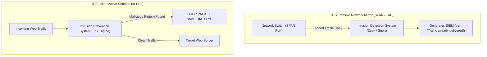
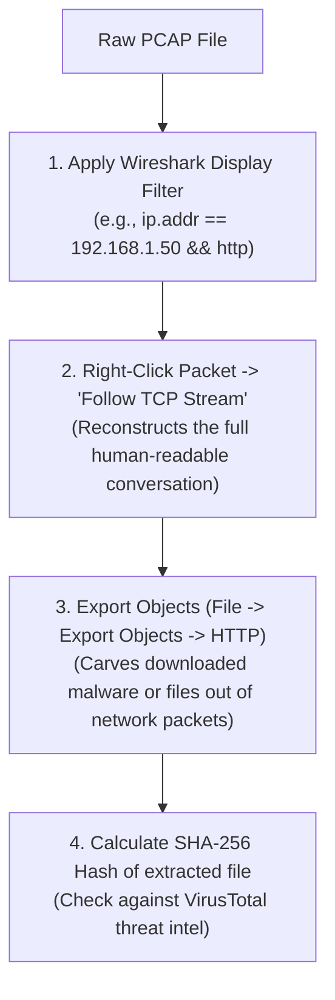

# 03. Network Security: IDS, IPS, Firewalls, and PCAP Analysis

[⬅️ Prev: EDR and XDR Mechanisms](./02_EDR_and_XDR_Mechanisms.md) | [Back to Technologies](./README.md) | [Next: Email Security Gateways ➡️](./04_Email_Security_Gateways_and_Phishing_Mechanisms.md)

---

### 🎓 Beginner's Compass: Decoded Acronyms & Terms
- **IDS (Intrusion Detection System)**: A passive network sensor (e.g., Snort, Suricata, Zeek) that listens to a copy of network traffic and generates alerts when malicious patterns are detected.
- **IPS (Intrusion Prevention System)**: An active inline network device sitting directly in the traffic flow that inspects packets and **drops malicious connections in real time**.
- **NGFW (Next-Generation Firewall)**: A modern firewall (e.g., Palo Alto Networks, Fortinet) capable of inspecting Layer 7 application traffic, SSL/TLS decryption, and user identity.
- **SPAN / TAP Port**: Hardware mirror ports on network switches that clone all live packets and send a copy to security monitoring sensors without impacting network speed.
- **PCAP (Packet Capture)**: A file format (viewable in Wireshark) containing an exact, byte-for-byte recording of network packets.
- **5-Tuple**: The five essential networking fields identifying any connection: `Source IP`, `Source Port`, `Destination IP`, `Destination Port`, and `Protocol (TCP/UDP)`.

---

### 1. Plain-English Walkthrough: The Guard with a Megaphone vs. The Bouncer

#### IDS (Passive Listener) vs. IPS (Active Blocker)
* **The IDS** is like a **security guard standing behind bulletproof glass holding a megaphone**:
  * The guard watches people walk through the lobby.
  * When a shoplifter runs past with stolen goods, the guard yells into the megaphone: *"Warning! Shoplifter in aisle 4!"*
  * The guard **cannot physically stop them**. By the time someone reacts, the shoplifter is already out the door.
* **The IPS** is like an **armed bouncer standing directly in the doorway**:
  * Every visitor must pass through the bouncer's turnstile.
  * If the bouncer spots a weapon, the bouncer **physically blocks the door and tackles the intruder on the spot**.
  * The malicious packet is dropped before it reaches the target server!

---

### 2. Next-Gen Firewalls: Port Filtering vs. Deep Packet Inspection (DPI)

Legacy firewalls only checked Layer 4 port numbers:
- If traffic was sent to **Port 80**, the firewall assumed it was safe web browsing.
- Hackers quickly realized this: they configured their malware and reverse shells to talk over Port 80 and Port 443!
- **Next-Generation Firewalls (NGFW)** use **Deep Packet Inspection (DPI)**:
  - An NGFW decrypts and inspects the payload regardless of port.
  - If it sees BitTorrent, SSH tunneling, or Cobalt Strike beacons running over Port 443, it identifies the application (App-ID) and blocks it instantly!

---

### 3. How a SOC Analyst Inspects a PCAP File

When deep network investigation is required, analysts open the PCAP file in **Wireshark**:

---

### 4. Common Beginner Mistakes vs. Best Practices

| Common Beginner Mistake | Real-World Risk | Industry Best Practice |
| :--- | :--- | :--- |
| **Deploying IPS without Tuning** | Putting an untuned IPS into active blocking mode can accidentally drop critical business database transactions (False Positives). | Run new IPS rules in **Alert-Only / Monitor Mode** for 14 to 30 days to baseline normal traffic before enabling active blocking. |
| **Ignoring TLS/SSL Encrypted Blind Spots** | Over 90% of web traffic is encrypted with HTTPS. An IDS inspecting encrypted packets without SSL Decryption sees only random gibberish. | Deploy **SSL/TLS Decryption Forward Proxies** on NGFWs to inspect outbound enterprise web sessions. |
| **Overwriting PCAP Buffers** | Full packet capture generates gigabytes per minute; small capture rings overwrite packets within 2 hours, losing evidence. | Store full PCAPs for critical perimeter links; use lightweight **NetFlow / Zeek metadata** for long-term 90-day retention. |

---

### 5. Recommended Next Steps
Learn how threat actors target the #1 attack vector in corporate history—email:
- [04. Email Security Gateways and Phishing Mechanisms Deep Dive ➡️](./04_Email_Security_Gateways_and_Phishing_Mechanisms.md)
