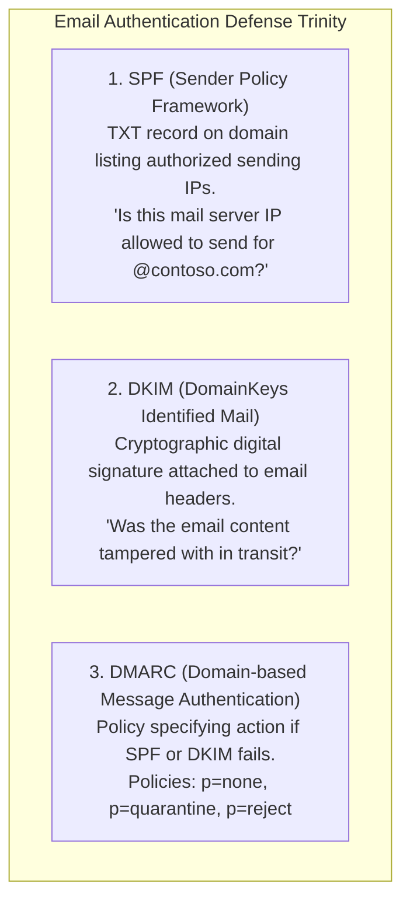

# 04. Email Security Gateways and Phishing Mechanisms

[⬅️ Prev: Network Security](./03_Network_Security_IDS_IPS_Firewalls_and_PCAP.md) | [Back to Technologies](./README.md) | [Next: Malware Analysis ➡️](./05_Malware_Analysis_Fundamentals_Static_vs_Dynamic.md)

---

### 1. Why Email is the #1 Initial Access Vector

Over 90% of successful corporate security breaches originate with a **Phishing Email**. It targets the human element, bypassing technical firewalls by convincing an employee to click a link or open an infected document.

---

### 2. Email Authentication Protocols: SPF, DKIM, DMARC

To understand email forgery and spoofing, analysts must master the email authentication trinity:



#### Anatomy of a Phishing Email Header:
```text
Return-Path: <attacker@spoofed-bank.com>
Received: from mail.evil-server.ru (203.0.113.88) by mail.contoso.com
Authentication-Results: spf=fail (sender IP 203.0.113.88 is not authorized by domain spoofed-bank.com)
dkim=fail (signature did not verify)
dmarc=fail action=quarantine
Subject: URGENT: Your corporate payroll account has been suspended!
```

---

### 3. Modern Secure Email Gateway (SEG) Capabilities

- **URL Sandboxing & Rewriting**: Rewrites all URLs inside incoming emails to point through a security proxy (e.g., `https://urldefense.proofpoint.com/...`). When the user clicks, the proxy tests the destination URL in real time.
- **Attachment Detonation**: Incoming attachments (PDF, DOCX, ZIP) are opened inside an isolated virtual machine to observe whether they attempt memory injection or malicious downloads.
