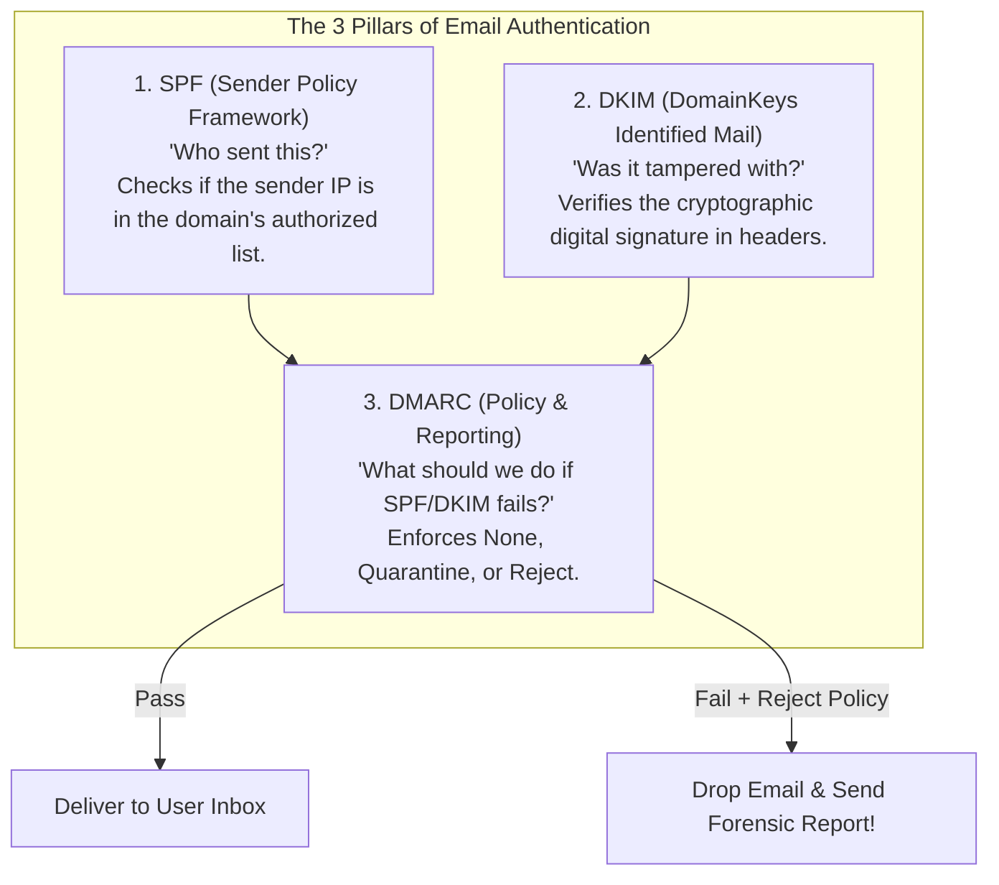
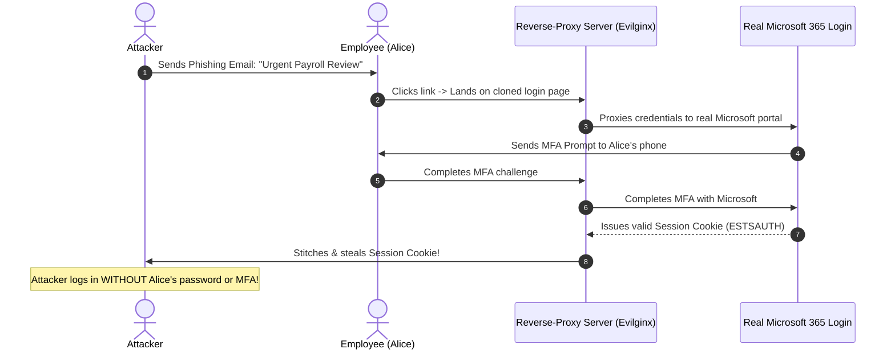

# 04. Email Security Gateways and Phishing Mechanisms

[⬅️ Prev: Network Security and PCAP](./03_Network_Security_IDS_IPS_Firewalls_and_PCAP.md) | [Back to Technologies](./README.md) | [Next: Malware Analysis Fundamentals ➡️](./05_Malware_Analysis_Fundamentals_Static_vs_Dynamic.md)

---

### 🎓 Beginner's Compass: Decoded Acronyms & Terms
- **SEG (Secure Email Gateway)**: The specialized security barrier (e.g., Proofpoint, Mimecast, Microsoft Defender for Office 365) that inspects all incoming and outgoing emails for malware, phishing, and spam before reaching user inboxes.
- **SPF (Sender Policy Framework)**: A public DNS record published by a domain listing the specific mail servers authorized to send emails on its behalf.
- **DKIM (DomainKeys Identified Mail)**: A cryptographic digital signature attached to email headers proving the message was not tampered with in transit.
- **DMARC**: The policy record that tells receiving mail servers what to do if SPF or DKIM fails (`p=none`, `p=quarantine`, `p=reject`).
- **BEC (Business Email Compromise)**: A social engineering scam where an attacker impersonates the CEO or a trusted vendor to trick finance into wiring millions of dollars.
- **URL Rewriting & Time-of-Click**: The security feature that replaces links inside emails with a secure gateway URL, re-checking the link for malware the exact second the user clicks it.

---

### 1. The Three Pillars of Email Anti-Spoofing: SPF, DKIM, and DMARC

Email was invented in the 1970s with **zero authentication**. Anyone could send an email claiming to be `ceo@apple.com`. Modern security uses three DNS-based pillars to fix this:



#### How to Read an SPF DNS Record:
```text
v=spf1 ip4:198.51.100.0/24 include:_spf.google.com -all
```
* `v=spf1`: Identifies this as an SPF record.
* `ip4:...`: Authorizes our corporate office mail servers.
* `include:_spf.google.com`: Authorizes Google Workspace mail servers.
* `-all`: **Hard Fail**: Any server NOT in this list is an unauthorized imposter; reject it!

#### The Three DMARC Policies:
1. `p=none`: Monitor only. Deliver failed emails anyway (used during testing).
2. `p=quarantine`: Send failed emails to the user's Junk/Spam folder.
3. `p=reject`: **The Gold Standard**: Block and delete the spoofed email completely before it ever touches the recipient's mailbox!

---

### 2. Modern Phishing Attacks: Weaponized Attachments & AiTM Reverse Proxies



This is called an **Adversary-in-the-Middle (AiTM)** phishing attack. Traditional SMS and TOTP MFA can be stolen this way!  
**The Solution**: Enforce **FIDO2 / Passkeys (YubiKey)** which bind the authentication session to the browser's exact domain origin.

---

### 3. Common Beginner Mistakes vs. Best Practices

| Common Beginner Mistake | Real-World Risk | Industry Best Practice |
| :--- | :--- | :--- |
| **Leaving DMARC on `p=none` indefinitely** | Attackers can spoof your company's domain to trick your customers because `p=none` takes no enforcement action. | Progress DMARC from `p=none` to `p=quarantine` to **`p=reject`** within 90 days. |
| **Trusting Display Names** | An email displaying *"CEO Tim Cook"* originating from `tim.cook.apple@gmail.com` bypasses SPF because Gmail's servers are legitimate. | Implement **Display Name Spoofing Rules** in your SEG that block external emails using internal executive names. |
| **Static Attachment Scanning Only** | Attackers use password-protected `.zip` files containing malware; static scanners cannot open encrypted archives. | Enforce **Dynamic Content Sandboxing** with automated prompt-password cracking or quarantine encrypted archives for user verification. |

---

### 4. Recommended Next Steps
Learn how malicious files and payloads are inspected in controlled forensic laboratories:
- [05. Malware Analysis Fundamentals: Static vs Dynamic Deep Dive ➡️](./05_Malware_Analysis_Fundamentals_Static_vs_Dynamic.md)
