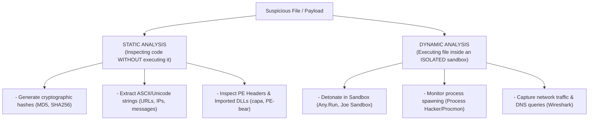

# 05. Malware Analysis Fundamentals: Static vs Dynamic Analysis

[⬅️ Prev: Email Security](./04_Email_Security_Gateways_and_Phishing_Mechanisms.md) | [Back to Technologies](./README.md) | [Next: Tools & Platforms Track ➡️](../04_Tools_and_Platforms/README.md)

---

### 1. The Objectives of Malware Triage for SOC Analysts

A SOC analyst is **NOT** typically expected to reverse engineer assembly code line-by-line for 3 weeks (that is the job of a dedicated Malware Reverse Engineer).

The SOC analyst's goal during an active incident is **Rapid Triage**:
1. *Is this suspicious file actually malicious?*
2. *What does it do (Capabilities: keylogger, ransomware, stealer)?*
3. *What are its Indicators of Compromise (C2 IPs, domains, dropped files, mutexes) so we can block them immediately across the enterprise?*

---

### 2. Static Analysis vs Dynamic Analysis

---

### 3. Essential Tools for Rapid Triage

- **VirusTotal**: Cloud hash and URL reputation scanner querying 70+ antivirus engines.
- **Floss / Strings**: Command-line utility to extract readable strings and de-obfuscate strings from binaries.
- **Capa**: Open-source tool from Mandiant that automatically detects capabilities (e.g., *"Checks if being debugged"*, *"Extracts credentials via Vault API"*).
- **ANY.RUN**: Interactive malware sandbox where analysts can interact directly with the running malware inside a secure cloud browser VM.
