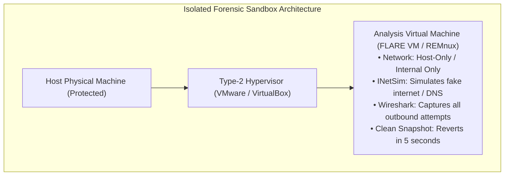
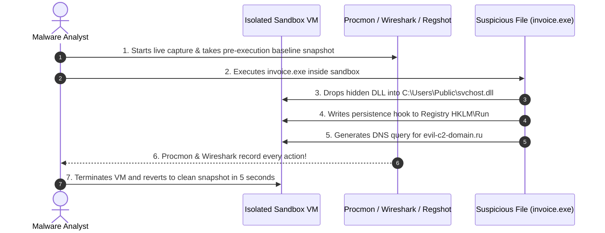

# 05. Malware Analysis Fundamentals: Static vs. Dynamic

[⬅️ Prev: Email Security Gateways](./04_Email_Security_Gateways_and_Phishing_Mechanisms.md) | [Back to Technologies](./README.md) | [Next: Cloud Security Monitoring ➡️](./06_Cloud_Security_Monitoring_AWS_Azure.md)

---

### 🎓 Beginner's Compass: Decoded Acronyms & Terms
- **Malware**: Malicious software designed to infiltrate, damage, or compromise computer systems (viruses, worms, trojans, ransomware, spyware).
- **Static Analysis**: Examining a suspicious file **without running it** (inspecting file hashes, text strings, headers, and assembly code).
- **Dynamic Analysis**: Executing a suspicious file in an isolated virtual sandbox and observing its live behavior (network beacons, dropped files, registry changes).
- **Sandbox**: A secure, isolated virtual machine environment (e.g., Any.Run, Cuckoo Sandbox) that can be safely infected and wiped clean with a snapshot.
- **PE Header (Portable Executable)**: The standard file format for Windows executables (`.exe`, `.dll`, `.sys`), containing architecture details, timestamps, and imported functions.
- **YARA**: A pattern-matching language used by malware researchers to describe and identify malware families based on textual or binary signatures.

---

### 1. The Cardinal Rule of Malware Analysis: Safety First!

> [!CAUTION]
> **NEVER analyze malware on your personal computer or corporate workstation!**  
> Malware analysis must **ONLY** take place inside an isolated virtual machine (e.g., FLARE VM, REMnux) configured with **Host-Only or Disabled Networking** and a clean base snapshot.

---

### 2. Static Analysis: Peeking Inside Without Executing

Static analysis is fast and safe. You inspect the binary using specialized tools:

#### Key Inspection Steps:
1. **Hashing**: Calculate MD5 and SHA-256 hashes (`sha256sum malware.exe`) and check them on VirusTotal.
2. **String Extraction (`strings -n 8 malware.exe`)**:
   * Look for hardcoded IP addresses, C2 domains, or registry persistence paths.
   * Look for encoded commands (e.g., `cmd.exe /c powershell -enc...`).
3. **PEStudio / CFF Explorer (Import Address Table - IAT)**:
   * Inspect the Windows APIs imported by the binary.
   * **Red Flags in API Imports**:
     * `VirtualAlloc` + `WriteProcessMemory` + `CreateRemoteThread`: **Process Injection Signature!**
     * `CryptEncrypt` + `CryptGenKey`: **Ransomware Encryption Signature!**
     * `GetAsyncKeyState`: **Keylogger Signature!**

---

### 3. Dynamic Analysis: Observing Live Behavioral Detonation

Dynamic analysis answers: *"What happens when the victim double-clicks this file?"*

#### The Standard Dynamic Triage Suite:
* **Process Monitor (Procmon)**: Captures every file system change, registry write, and process creation in real time.
* **Process Explorer (Procexp)**: Shows running processes in a live parent-child tree, highlighting unverified signatures.
* **Wireshark / INetSim**: Captures DNS queries and outbound HTTP/TCP beacons initiated by the malware.
* **Regshot**: Takes a snapshot of the Windows Registry before and after execution to pinpoint where the malware hid its persistence hooks!

---

### 4. Common Beginner Mistakes vs. Best Practices

| Common Beginner Mistake | Real-World Risk | Industry Best Practice |
| :--- | :--- | :--- |
| **Leaving Sandbox Internet Enabled** | Giving live internet to malware allows ransomware to phone home, grab real encryption keys, and exfiltrate host data. | Use **fake network simulators (INetSim / FakeNet-NG)** to simulate internet responses safely without real outbound access. |
| **Ignoring Evasion Techniques** | Advanced malware detects virtual machines (checking for VMware tools, screen resolution, mouse movement) and sleeps to hide. | Use **hardened anti-analysis sandboxes** or interact with the virtual desktop (move the mouse, open documents) to trick malware into detonating. |
| **Relying solely on VirusTotal** | If a targeted APT compiles brand-new custom malware, it will have 0 detections on VirusTotal. | Perform **manual behavioral analysis**: inspect memory allocations and process spawning regardless of antivirus score. |

---

### 5. Recommended Next Steps
Learn how security monitoring expands into cloud platforms like AWS and Microsoft Azure:
- [06. Cloud Security Monitoring: AWS and Azure ➡️](./06_Cloud_Security_Monitoring_AWS_Azure.md)
