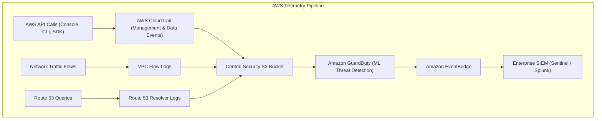

# 06. Cloud Security Monitoring: AWS CloudTrail, GuardDuty, and Azure Monitor

[⬅️ Prev: Malware Analysis](./05_Malware_Analysis_Fundamentals_Static_vs_Dynamic.md) | [Back to Technologies](./README.md) | [Next: Tools Track ➡️](../04_Tools_and_Platforms/README.md)

---

### 1. The Shift to Cloud Telemetry

Monitoring cloud workloads differs fundamentally from monitoring physical on-premises servers:
- On-premises: Attackers exploit operating system binaries, network switches, and physical cables.
- In Cloud: **The API is the infrastructure**. An attacker who compromises an API token can spin up 100 servers, download entire relational databases, or delete all backups with a single HTTPS `POST` request.

---

### 2. AWS Cloud Monitoring Architecture

#### High-Severity AWS CloudTrail Events Every Analyst Watches:
| CloudTrail Event Name | Security Significance |
| :--- | :--- |
| `ConsoleLogin` with `errorMessage = "Failed authentication"` | Brute-force or password spray against AWS root/IAM user. |
| `StopLogging` / `DeleteTrail` | Attacker attempting to blind defense monitoring. |
| `AuthorizeSecurityGroupIngress` with `0.0.0.0/0` | Security group opened to the entire public internet. |
| `CreateAccessKey` | Attacker establishing persistent programmatic access on a compromised user. |
| `PutBucketPolicy` / `PutBucketAcl` | S3 bucket modified to allow unauthorized or public reads. |

---

### 3. Azure Cloud Telemetry & Activity Logs

In Microsoft Azure, security operations centers monitor four core logging tiers:
1. **Azure Activity Logs**: Subscription-level events documenting management operations (e.g., `Create or Update Virtual Machine`, `Delete SQL Database`).
2. **Microsoft Entra ID Sign-in & Audit Logs**: All cloud authentications, risk detections, and directory modifications.
3. **Azure Resource Diagnostic Logs**: Detailed operational logs emitted by specific cloud PaaS services (e.g., Azure Key Vault access, CosmosDB transactions).
4. **Network Security Group (NSG) Flow Logs**: Layer 4 IP flow records showing allowed and denied traffic across Azure subnets.
