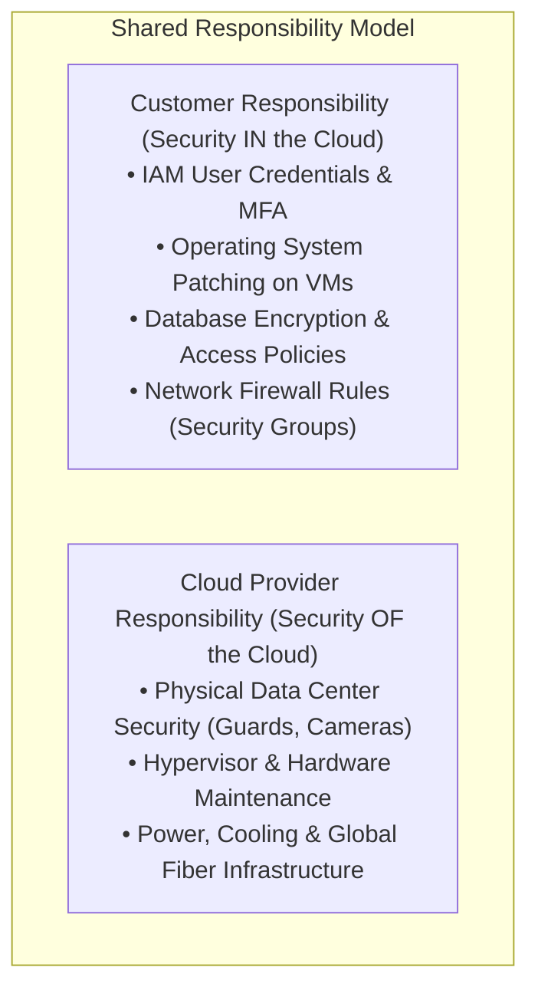

# 06. Cloud Security Monitoring: AWS and Azure

[⬅️ Prev: Malware Analysis Fundamentals](./05_Malware_Analysis_Fundamentals_Static_vs_Dynamic.md) | [Back to Technologies](./README.md) | [Next: Tools and Platforms Track ➡️](../04_Tools_and_Platforms/README.md)

---

### 🎓 Beginner's Compass: Decoded Acronyms & Terms
- **CSPM (Cloud Security Posture Management)**: Automated scanning of cloud accounts (AWS, Azure, GCP) to find misconfigurations (e.g., publicly accessible S3 storage buckets).
- **CWPP (Cloud Workload Protection Platform)**: EDR tailored for cloud virtual machines, containers (Docker), and serverless functions (AWS Lambda).
- **AWS CloudTrail**: The immutable audit log recording every single API call made in an AWS account (who, what, when, from which IP).
- **AWS GuardDuty**: An intelligent threat detection service in AWS that uses machine learning to flag compromised credentials and cryptocurrency mining.
- **Azure Activity Log / Microsoft Defender for Cloud**: Microsoft's cloud control-plane logging and threat detection suite.
- **Shared Responsibility Model**: The legal and operational division of security duties between the cloud provider (AWS/Microsoft) and the customer.

---

### 1. Plain-English Walkthrough: The Cloud Rental Apartment Analogy

#### The Shared Responsibility Model
Think of renting an apartment in a high-rise building:
- **The Landlord (AWS / Microsoft Azure)** is responsible for:
  - The physical concrete foundation, the roof, the elevators, the building perimeter locks, and the electrical wiring (**Security OF the Cloud**).
- **The Tenant (You / The Customer)** is responsible for:
  - Who you invite into your apartment, locking your front deadbolt, not leaving the stove on, and not taping your apartment keys to the front door! (**Security IN the Cloud**).
- If an employee uploads their AWS secret access key to a public GitHub repository, **AWS will not stop the hacker from logging in**. That is the customer's responsibility!

---

### 2. AWS vs. Azure: Core SOC Telemetry Mapping

| Telemetry Domain | Amazon Web Services (AWS) | Microsoft Azure |
| :--- | :--- | :--- |
| **Control Plane Audit Logs** | **AWS CloudTrail** (Records all API calls) | **Azure Activity Log** (Records resource changes) |
| **Intelligent Threat Detection** | **AWS GuardDuty** (ML anomaly detection) | **Microsoft Defender for Cloud** |
| **Network Flow Telemetry** | **VPC Flow Logs** (Network traffic records) | **NSG Flow Logs / Virtual Network TAP** |
| **Identity & Access Management** | **AWS IAM** (Roles, Policies, STS) | **Microsoft Entra ID** (Conditional Access, PIM) |
| **Central SIEM Ingestion** | S3 Bucket -> Amazon Security Lake -> SIEM | Azure Event Hub -> Microsoft Sentinel |

---

### 3. Top 3 Cloud Attack Patterns Every SOC Analyst Investigates

#### 1. Leaked Cloud Credentials & Crypto Mining
* **The Attack**: A junior developer commits an AWS Access Key (`AKIA...`) to a public GitHub repository. Within 90 seconds, automated bot scrapers find the key and launch 50 massive GPU virtual machines in the Oregon region to mine Monero cryptocurrency.
* **SOC Detection**: AWS GuardDuty alerts on `CryptoCurrency:EC2/BitcoinTool.B!DNS`.

#### 2. Public Storage Bucket Exposure
* **The Attack**: An engineer sets an AWS S3 bucket or Azure Blob container permission to `Public Read` to share a logo, inadvertently exposing 500,000 confidential PDF customer invoices.
* **SOC Detection**: CloudTrail event `PutBucketAcl` with URI containing `AllUsers` or `AuthenticatedUsers`.

#### 3. CloudTrail Disruption (Defense Evasion)
* **The Attack**: An attacker compromises an administrative account. Their very first command is `aws cloudtrail stop-logging` to blind the SOC team!
* **SOC Detection**: Instant P1 Critical Alert triggered by the SIEM on event `StopLogging`.

---

### 4. Common Beginner Mistakes vs. Best Practices

| Common Beginner Mistake | Real-World Risk | Industry Best Practice |
| :--- | :--- | :--- |
| **Using AWS Root Account for Daily Work** | Compromising the AWS root account gives attackers total, irreversible ownership of the entire company infrastructure. | Lock away the root account with a physical hardware MFA token; use **AWS IAM Identity Center** with temporary role assumption. |
| **Storing CloudTrail in the Same Account** | If an attacker compromises the production account, they can delete the S3 bucket holding the CloudTrail audit logs to erase evidence. | Ship CloudTrail logs to a dedicated, isolated **Log Archive AWS Account** with immutable S3 Object Lock (WORM - Write Once, Read Many). |
| **Ignoring Ingress Security Groups** | Setting Security Group rules to `0.0.0.0/0` on Port 22 (SSH) or Port 3389 (RDP) invites continuous automated brute force attacks. | Ban direct public RDP/SSH; require connections via **AWS Systems Manager (SSM) Session Manager** or Azure Bastion. |

---

### 5. Recommended Next Steps
Now that you have mastered SOC technologies and cloud architectures, explore the leading enterprise tools used by analysts:
- [04. Tools and Platforms: Microsoft Sentinel and KQL Deep Dive ➡️](../04_Tools_and_Platforms/01_Microsoft_Sentinel_and_KQL.md)
