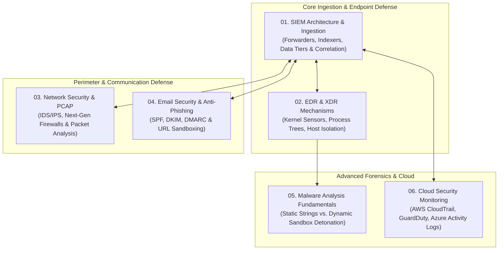

# 03. SOC Technologies and Architectures Track

In this module, we explore the core technologies, detection platforms, and defensive hardware/software architectures that power modern Security Operations Centers.

---

### 🗺️ Module Learning Pathway

---

### 📚 Technologies at a Glance: The SOC Arsenal

| Document | Primary Technology | Practical Analogy |
| :--- | :--- | :--- |
| **[01. SIEM Architecture & Ingestion](./01_SIEM_Architecture_and_Data_Ingestion.md)** | Splunk, Microsoft Sentinel, Logstash | The air traffic control tower radar screen |
| **[02. EDR and XDR Mechanisms](./02_EDR_and_XDR_Mechanisms.md)** | CrowdStrike Falcon, Defender for Endpoint | The internal armed security guard standing by every office desk |
| **[03. Network Security & PCAP](./03_Network_Security_IDS_IPS_Firewalls_and_PCAP.md)** | Snort, Suricata, Zeek, Palo Alto, Wireshark | The airport luggage X-ray scanners and border checkpoint gates |
| **[04. Email Security Gateways](./04_Email_Security_Gateways_and_Phishing_Mechanisms.md)** | Proofpoint, Mimecast, SPF, DKIM, DMARC | The postal hazardous materials bomb-sniffing inspection facility |
| **[05. Malware Analysis Fundamentals](./05_Malware_Analysis_Fundamentals_Static_vs_Dynamic.md)** | Any.Run, Ghidra, Procmon, PEStudio | The biological hazard bio-safety lab examining infectious viruses |
| **[06. Cloud Security Monitoring](./06_Cloud_Security_Monitoring_AWS_Azure.md)** | AWS CloudTrail, GuardDuty, Azure Sentinel | Security cameras monitoring remote sky-hangars and cloud warehouses |
