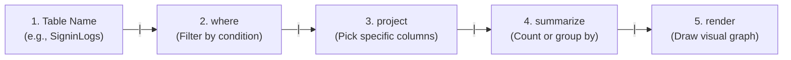

# 01. Microsoft Sentinel and KQL

[⬅️ Back to Tools Track](./README.md) | [Next: Splunk Enterprise Security ➡️](./02_Splunk_Enterprise_Security_and_SPL.md)

---

### 🎓 Beginner's Compass: Decoded Acronyms & Terms
- **Microsoft Sentinel**: Microsoft's cloud-native SIEM and SOAR platform built inside Azure.
- **Log Analytics Workspace (LAW)**: The underlying database engine in Azure where all Sentinel tables and logs are stored.
- **KQL (Kusto Query Language)**: The fast, read-only query language used to search and analyze telemetry in Sentinel and Microsoft Defender.
- **Analytic Rule**: An automated scheduled KQL query that runs every X minutes and generates an incident if results exceed a threshold.
- **Playbook**: An automated response workflow built on Azure Logic Apps (e.g., automatically posting a message to Teams and isolating a host when a high alert fires).

---

### 1. Plain-English Walkthrough: The Pipeline Architecture of KQL

KQL queries flow like a pipeline from left to right using the **pipe character (`|`)**.  
Think of it like an assembly line: each step takes the results of the previous step, filters it, transforms it, and hands it to the next step.



---

### 2. The Essential KQL Cheat Sheet for SOC Analysts

Memorize these core operators:

| Operator | What It Does | Real-World Example |
| :--- | :--- | :--- |
| `where` | Filters rows matching a condition | `SigninLogs \| where ResultType != 0` (Find failed logins) |
| `project` | Selects which columns to show | `SigninLogs \| project TimeGenerated, UserPrincipalName, IPAddress` |
| `project-away` | Hides specific columns | `SigninLogs \| project-away CorrelationId` |
| `summarize` | Calculates aggregations (count, sum, avg) | `SigninLogs \| summarize FailedAttempts = count() by IPAddress` |
| `bin()` | Groups timestamps into buckets | `summarize count() by bin(TimeGenerated, 1h)` |
| `top` | Returns top N rows sorted | `top 10 by FailedAttempts desc` |
| `render` | Generates visual charts | `render timechart` or `render barchart` |

---

### 3. Production KQL Queries Every Analyst Must Know

#### Query 1: Detect Brute Force / Password Spraying
Searches for external IP addresses generating more than 20 failed logins within 1 hour:

```kusto
SigninLogs
| where TimeGenerated > ago(24h)
| where ResultType != 0  // 0 means success; non-zero means failure
| summarize 
    FailedLogins = count(),
    TargetedAccounts = dcount(UserPrincipalName),
    TargetUsersList = make_set(UserPrincipalName, 10)
    by IPAddress, Location
| where FailedLogins >= 20
| order by FailedLogins desc
```

#### Query 2: Detect Encoded PowerShell Execution (Living-off-the-Land)
Searches endpoint process logs for obfuscated, hidden Base64 commands:

```kusto
DeviceProcessEvents
| where TimeGenerated > ago(7d)
| where ProcessCommandLine has_any ("-enc", "-encodedcommand", "-w hidden", "downloadstring", "iex")
| project 
    TimeGenerated, 
    DeviceName, 
    AccountName, 
    InitiatingProcessFileName, 
    FileName, 
    ProcessCommandLine
| order by TimeGenerated desc
```

---

### 4. Common Beginner Mistakes vs. Best Practices

| Common Beginner Mistake | Real-World Risk | Industry Best Practice |
| :--- | :--- | :--- |
| **Omitting Time Boundaries (`ago()`)** | Querying a table without `where TimeGenerated > ago(1d)` forces Sentinel to scan 90 days of terabytes, resulting in query timeouts. | **Always start every KQL query with a strict time filter** as the very first line after the table name. |
| **Using `contains` instead of `has`** | `contains` performs slow substring searches (`in` in `winword`). | Use **`has`** or **`has_cs`** for fast, indexed full-word token matching. |
| **Editing Production Rules Directly** | Modifying live analytic rules in production can break corporate threat alerts for the entire team. | Test changes in **Hunting Queries** or create a duplicate rule in **Disabled / Test** mode first. |

---

### 5. Recommended Next Steps
Learn how the leading enterprise competitor to Sentinel operates:
- [02. Splunk Enterprise Security and SPL Deep Dive ➡️](./02_Splunk_Enterprise_Security_and_SPL.md)
