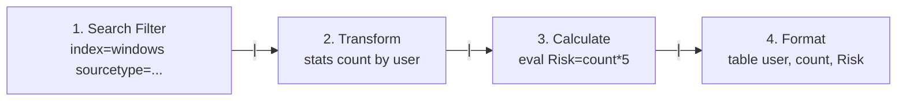

# 02. Splunk Enterprise Security and SPL

[⬅️ Prev: Microsoft Sentinel](./01_Microsoft_Sentinel_and_KQL.md) | [Back to Tools Track](./README.md) | [Next: CrowdStrike and Defender ➡️](./03_CrowdStrike_Falcon_and_Defender_for_Endpoint.md)

---

### 🎓 Beginner's Compass: Decoded Acronyms & Terms
- **Splunk Enterprise**: A powerful data platform that ingests, indexes, and searches machine-generated data from almost any source.
- **Splunk ES (Enterprise Security)**: The specialized SIEM application running on top of Splunk providing correlation searches, notable events, and risk scoring.
- **SPL (Search Processing Language)**: Splunk's proprietary search language containing over 140 commands used to query and transform indexed data.
- **Index**: A logical partition or database where specific logs are stored (e.g., `index=windows`, `index=firewall`).
- **Sourcetype**: The label identifying the exact format of the incoming log data (e.g., `sourcetype=XmlWinEventLog:Security`).
- **Notable Event**: A confirmed security incident created by a Splunk correlation search appearing on the incident review dashboard.

---

### 1. Plain-English Walkthrough: The Search Processing Language (SPL)

Like KQL, Splunk searches use the **pipe (`|`)** symbol:
* The text before the first pipe is the **Raw Search** (fast retrieval from hard drive indexes).
* Everything after the pipe transforms, groups, filters, or formats the retrieved records into tables and charts.



---

### 2. The Essential SPL Cheat Sheet for SOC Analysts

| Command | What It Does | Example Usage |
| :--- | :--- | :--- |
| `index=` | Specifies the storage database | `index=firewall` |
| `sourcetype=` | Specifies log format parser | `sourcetype=pan:traffic` |
| `stats` | Aggregates and counts data | `stats count dc(user) by src_ip` (`dc` = distinct count) |
| `eval` | Creates or modifies a new field | `eval MB = round(bytes/1024/1024, 2)` |
| `table` | Displays only specified columns | `table _time, src_ip, dst_ip, action` |
| `rex` | Extracts fields using regular expressions | `rex field=uri "(?<malicious_param>[a-zA-Z0-9]{30,})"` |
| `lookup` | Enriches data against CSV lists | `lookup threat_intel_feed.csv ip as dst_ip OUTPUT threat_actor` |
| `dedup` | Removes duplicate consecutive rows | `dedup src_ip` |

---

### 3. Production SPL Queries for Alert Triage

#### Query 1: Detect Internal Port Scanning Across Subnets
```spl
index=firewall action=blocked
| stats dc(dest_port) as unique_ports, count as total_blocks by src_ip
| where unique_ports > 100
| sort - unique_ports
```

#### Query 2: Detect Rare Process Executions on Endpoints
Finds unusual programs running on workstations that only appear once across the entire company:
```spl
index=windows EventCode=4688
| stats count by NewProcessName
| where count == 1
| sort count
```

---

### 4. Common Beginner Mistakes vs. Best Practices

| Common Beginner Mistake | Real-World Risk | Industry Best Practice |
| :--- | :--- | :--- |
| **Omitting the `index` specification** | Typing `index=*` searches every index across the entire company (including gigabytes of application debug logs), grinding the search head to a halt. | **Always specify the exact index** (e.g., `index=windows` or `index=network`). |
| **Putting streaming filters after statistical commands** | Filtering data *after* aggregating with `stats` processes unnecessary gigabytes of memory. | Filter as early as possible on the left side of the pipe before applying statistical transformations. |
| **Hardcoding CSV lookups without maintenance** | Storing threat intelligence in static manual lookup tables causes lookups to fail as IPs rotate. | Automate lookup updates using **Threat Intelligence Framework (TIF)** or REST API feeds. |

---

### 5. Recommended Next Steps
Learn how endpoint detection tools investigate process execution trees and isolate hosts:
- [03. CrowdStrike Falcon and Microsoft Defender for Endpoint Deep Dive ➡️](./03_CrowdStrike_Falcon_and_Defender_for_Endpoint.md)
