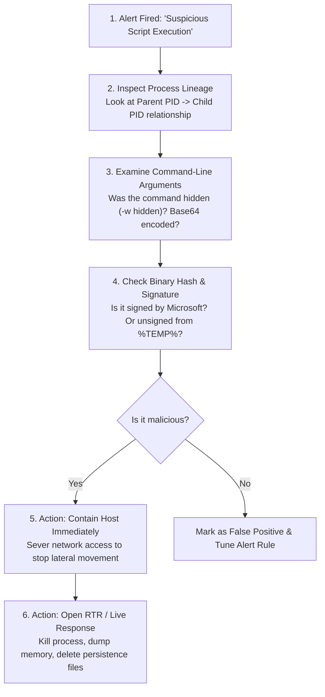

# 03. CrowdStrike Falcon and Microsoft Defender for Endpoint

[⬅️ Prev: Splunk Enterprise Security](./02_Splunk_Enterprise_Security_and_SPL.md) | [Back to Tools Track](./README.md) | [Next: Wireshark and Network Forensics ➡️](./04_Wireshark_and_Network_Forensics.md)

---

### 🎓 Beginner's Compass: Decoded Acronyms & Terms
- **CrowdStrike Falcon**: The market-leading cloud-native EDR platform that uses a single lightweight kernel agent and the proprietary "Threat Graph" to stop breaches.
- **Microsoft Defender for Endpoint (MDE)**: Microsoft's enterprise EDR built directly into Windows 10/11 and Windows Server (no extra agent installation required on modern Windows).
- **Process Lineage (Tree)**: The chronological visualization of which parent application spawned which child process.
- **RTR (Real-Time Response) / Live Response**: A remote terminal session embedded in the EDR console that gives the SOC analyst interactive shell access to a machine over an encrypted cloud tunnel.
- **AIR (Automated Investigation & Remediation)**: Microsoft's AI engine that automatically hunts for related artifacts across thousands of endpoints and quarantines malware without human intervention.

---

### 1. Side-by-Side Comparison: Falcon vs. Defender for Endpoint

| Feature | CrowdStrike Falcon | Microsoft Defender for Endpoint (MDE) |
| :--- | :--- | :--- |
| **Agent Architecture** | Single lightweight kernel sensor (Falcon Sensor) | Built directly into Windows OS kernel; separate agent for Linux/Mac |
| **Cloud Brain** | CrowdStrike Threat Graph | Microsoft Security Graph & Defender XDR |
| **Remote Shell Tool** | **Real-Time Response (RTR)** | **Live Response** |
| **Automated Remediation** | Falcon Fusion Workflows | Automated Investigation and Remediation (AIR) |
| **Host Containment** | Network Containment (One-click) | Isolate Device (One-click, allows Outlook/Teams option) |
| **Primary Query Language** | Falcon LogScale / CQL | Kusto Query Language (KQL) |

---

### 2. How to Triage an Alert Inside an EDR Console

When an alert appears on your screen:



---

### 3. Essential Real-Time Response (RTR) Commands

When an analyst connects to a live compromised host via RTR/Live Response:

```bash
# 1. View all running processes on the host
ps

# 2. Kill the malicious process by Process ID
kill -pid 4092

# 3. View established network connections
netstat

# 4. Remove malicious persistence binary from disk
rm "C:\Users\Public\backdoor.exe"

# 5. Extract a forensic memory dump of a specific suspicious process
memdump 4092 "C:\Forensics\suspicious_process.dmp"

# 6. Retrieve a file from the host back to your SOC workstation for malware analysis
get "C:\Windows\Temp\payload.dll"
```

---

### 4. Common Beginner Mistakes vs. Best Practices

| Common Beginner Mistake | Real-World Risk | Industry Best Practice |
| :--- | :--- | :--- |
| **Un-containing a host too early** | Lifting network isolation before verifying that all persistence mechanisms (registry, scheduled tasks) are purged allows the attacker to resume operations. | Keep the host contained until full **post-remediation forensic verification** is completed. |
| **Running remediation commands locally on the physical machine** | Walking over to the physical laptop and typing on the keyboard triggers anti-forensic wiper scripts configured by the attacker. | Execute all containment, memory acquisition, and artifact gathering remotely through **isolated EDR Live Response**. |
| **Ignoring Duplicate Detections** | Treating 5 detections on 5 machines as separate tickets blinds you to a coordinated enterprise-wide campaign. | Correlate alerts by **File Hash**, **Parent Process**, and **External C2 IP** to scope the full infection campaign. |

---

### 5. Recommended Next Steps
Learn how network packets are reconstructed and inspected at the binary level:
- [04. Wireshark and Network Forensics Deep Dive ➡️](./04_Wireshark_and_Network_Forensics.md)
