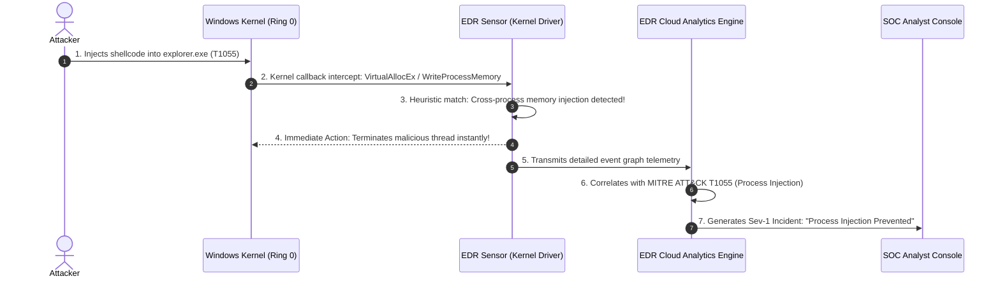

# 03. CrowdStrike Falcon and Microsoft Defender for Endpoint (MDE) Deep Dive

[⬅️ Prev: Splunk](./02_Splunk_Enterprise_Security_and_SPL.md) | [Back to Tools](./README.md) | [Next: Wireshark & Forensics ➡️](./04_Wireshark_and_Network_Forensics.md)

---

### 1. Platform Overview & Architecture

**CrowdStrike Falcon** and **Microsoft Defender for Endpoint (MDE)** are the two dominant enterprise **Endpoint Detection and Response (EDR / XDR)** platforms.

Unlike legacy antivirus that relies on static file signatures, modern EDR sensors operate at **Ring 0 (OS Kernel level)** using kernel drivers on Windows or **eBPF** on Linux:
- They continuously record process creations, DLL loads, registry modifications, network sockets, and memory allocations.
- They evaluate behavioral heuristics in real time to intercept attacks *as they happen*.



---

### 2. Live Response Console Commands

When an analyst isolates an endpoint, they interact with the victim host remotely via the EDR **Live Response Shell**:

#### CrowdStrike Falcon Real-Time Response (RTR) Commands:
```bash
# 1. View running processes and identify suspicious PID
ps

# 2. Kill malicious process by PID immediately
kill -PID 5824

# 3. View active network connections from host
netstat

# 4. Dump memory of a specific process for forensic offline analysis
memdump -Target="lsass.exe" -Destination="C:\Temp\lsass.dmp"

# 5. Extract a dropped malware file to the analyst workstation safely
get "C:\Users\victim\AppData\Local\Temp\malware.exe"

# 6. Delete a persistence registry key
reg delete "HKCU\Software\Microsoft\Windows\CurrentVersion\Run" -Value "Updater"
```

#### Microsoft Defender for Endpoint (MDE) Live Response Commands:
```powershell
# 1. Isolate the machine from the corporate network
isolate device

# 2. Collect comprehensive forensic investigation package
collect investigation package

# 3. Run automated remediation script from cloud library
run script -ScriptName "Check-Persistence-RegKeys.ps1"

# 4. Stop and quarantine a malicious process and binary
remediate -File "C:\ProgramData\payload.exe"
```

---

### 3. Reading the EDR Process Lineage Tree

During triage, an analyst reads the **Process Execution Tree** to understand the root cause:

```text
[Lineage Tree Triage Example]
├─► explorer.exe (PID: 2840) [User Desktop]
│    └─► outlook.exe (PID: 3912) [User opened Outlook]
│         └─► winword.exe (PID: 5410) [Opened "Invoice.docm"]
│              └─► 🚨 cmd.exe (PID: 6012) [VBA Macro spawned Command Prompt!]
│                   └─► 🚨 powershell.exe (PID: 6180) -nop -w hidden -enc aWV4I...
│                        └─► conhost.exe (PID: 6184)
│                        └─► 🚨 whoami.exe (PID: 7100) [Reconnaissance]
```

**Analyst Diagnosis**: The user received a spear-phishing email in Outlook, opened a malicious macro-enabled Word document, and the macro spawned PowerShell to download a remote backdoor. Immediate containment required!
