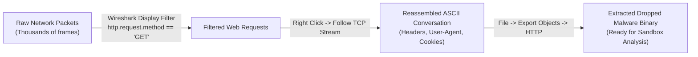

# 04. Wireshark and Network Forensics

[⬅️ Prev: CrowdStrike and Defender](./03_CrowdStrike_Falcon_and_Defender_for_Endpoint.md) | [Back to Tools Track](./README.md) | [Next: OSINT and Investigation Tools ➡️](./05_OSINT_and_Investigation_Tools_VirusTotal_AbuseIPDB.md)

---

### 🎓 Beginner's Compass: Decoded Acronyms & Terms
- **Wireshark**: The world's most widely used network packet analyzer, displaying raw network traffic captured from network interfaces.
- **Display Filter**: A query applied inside Wireshark to filter already captured packets without changing the capture file (e.g., `http.request`).
- **Capture Filter (BPF)**: A filter applied *before* capturing packets (Berkeley Packet Filter syntax) to capture only specific traffic (e.g., `host 192.168.1.1`).
- **Follow TCP Stream**: A feature that reassembles all sequential packets in a TCP conversation into a clean, human-readable text window.
- **Object Carving (Export Objects)**: Reconstructing and extracting files (EXEs, PDFs, images) that were transferred across unencrypted network streams.

---

### 1. Plain-English Walkthrough: The Wiretap Recording

Think of a network like a telephone line:
- Firewalls only see the **caller ID** and the **phone number dialed** (Layer 3 and Layer 4).
- **Wireshark records the actual voices speaking on the call** (Layer 7 payload).
- If an attacker downloads malware over unencrypted HTTP, Wireshark allows you to **carve the exact `.exe` file directly out of the recorded network packets!**



---

### 2. Essential Wireshark Display Filters for Alert Triage

| Goal | Display Filter Syntax | What It Reveals |
| :--- | :--- | :--- |
| **Filter by Host IP** | `ip.addr == 192.168.1.50` | All traffic where the host is either source or destination. |
| **Filter by Port** | `tcp.port == 443 || udp.port == 53` | HTTPS and DNS traffic only. |
| **Find HTTP POST Requests** | `http.request.method == "POST"` | Data submission forms (credentials, file uploads, C2 beacons). |
| **Find DNS Queries** | `dns.flags.response == 0` | Domain name lookups requested by compromised endpoints. |
| **Find SYN Packets (Port Scans)** | `tcp.flags.syn == 1 && tcp.flags.ack == 0` | Inbound connection attempts and port scan probes. |
| **Search Packet Contents** | `frame contains "password"` | Searches raw payload bytes for specific keywords. |

---

### 3. Step-by-Step: Carving Dropped Payloads Out of Network Traffic

If an alert states that an employee downloaded an unverified executable:
1. Open the PCAP file in Wireshark.
2. Navigate to **File** > **Export Objects** > **HTTP...** (or **SMB...** if internal file share).
3. Wireshark parses the stream and displays a list of every file downloaded:
   * Filename: `invoice_details.exe`
   * Content Type: `application/octet-stream`
   * Size: `248 KB`
4. Click **Save** to write the binary to an isolated forensic folder.
5. Calculate its SHA-256 hash using PowerShell or Linux:
   ```bash
   sha256sum invoice_details.exe
   ```
6. Submit the hash to VirusTotal to verify malicious reputation!

---

### 4. Common Beginner Mistakes vs. Best Practices

| Common Beginner Mistake | Real-World Risk | Industry Best Practice |
| :--- | :--- | :--- |
| **Opening giant 5GB PCAPs directly** | Opening multi-gigabyte PCAP files freezes Wireshark and crashes local RAM. | Split large PCAP files using command-line `editcap` or filter packets with `tshark` before opening in GUI. |
| **Confusing Display vs Capture Filters** | Using display filter syntax (`ip.addr ==`) in capture filter prompts causes capture engines to throw syntax errors. | Memorize BPF syntax for capture filters: `host 10.0.0.1 and port 80`; use display filters for post-capture analysis. |
| **Assuming all traffic can be read** | Trying to read encrypted TLS 1.3 payloads without private session keys shows only encrypted ciphertext. | Extract TLS session keys (`SSLKEYLOGFILE`) or analyze unencrypted metadata (SNI - Server Name Indication). |

---

### 5. Recommended Next Steps
Learn how to triage indicators of compromise using open-source threat intelligence tools:
- [05. OSINT and Investigation Tools: VirusTotal, AbuseIPDB, and CyberChef Deep Dive ➡️](./05_OSINT_and_Investigation_Tools_VirusTotal_AbuseIPDB.md)
