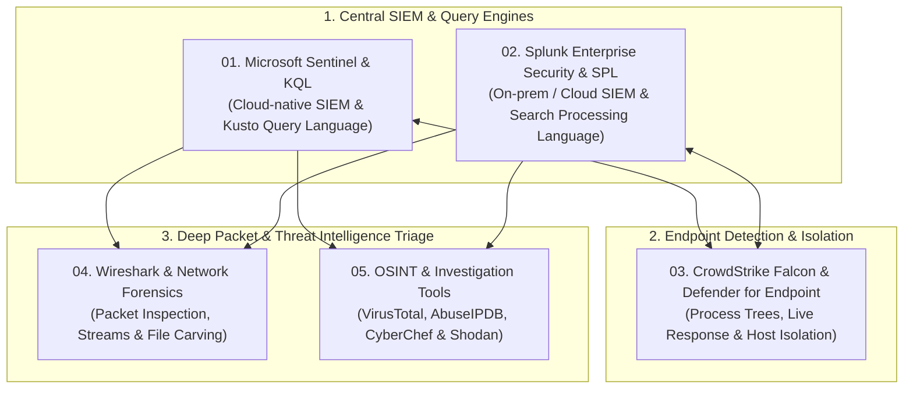

# 04. SOC Tools and Platforms Track

To perform on day one as a Security Operations Center analyst, you must be comfortable navigating enterprise consoles, writing query syntax, and using forensic triage tools.

---

### 🗺️ The SOC Analyst's Operational Toolchain

---

### 📚 Tools at a Glance: The Enterprise Arsenal

| Tool Platform | Category | Primary Query / Action | Typical Daily Use Case |
| :--- | :--- | :--- | :--- |
| **[01. Microsoft Sentinel](./01_Microsoft_Sentinel_and_KQL.md)** | Cloud SIEM | **KQL** (Kusto Query Language) | Ingesting Azure/M365 logs and triaging high-priority alerts. |
| **[02. Splunk Enterprise Security](./02_Splunk_Enterprise_Security_and_SPL.md)** | Enterprise SIEM | **SPL** (Search Processing Language) | Searching terabytes of on-premises and multi-cloud logs. |
| **[03. CrowdStrike & Defender](./03_CrowdStrike_Falcon_and_Defender_for_Endpoint.md)** | EDR / XDR | Live Response / Host Isolation | Inspecting process spawning and severing infected hosts from network. |
| **[04. Wireshark](./04_Wireshark_and_Network_Forensics.md)** | Packet Analysis | Display Filters (`ip.addr`, `http`) | Reconstructing raw TCP streams and extracting dropped malware payloads. |
| **[05. OSINT Triage Tools](./05_OSINT_and_Investigation_Tools_VirusTotal_AbuseIPDB.md)** | Threat Intel | Reputation Lookups & Decoding | Verifying whether suspicious IPs, hashes, or encoded commands are evil. |
