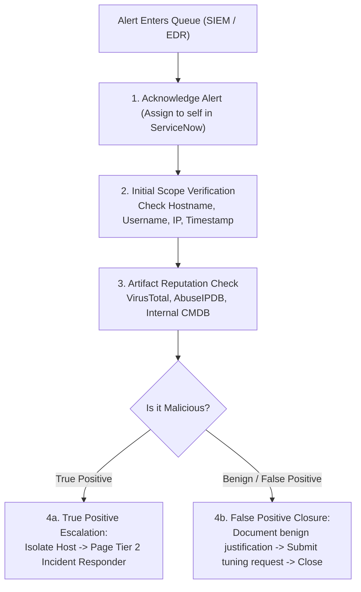

# 01. Alert Ingestion and Queue Triage SOP

[⬅️ Back to Workflows](./README.md) | [Next: End-to-End Investigation ➡️](./02_End_to_End_Incident_Investigation_Workflow.md)

---

### 🎓 Beginner's Compass: Decoded Tools in This SOP
- **Ticketing System (ITSM)**: Software (ServiceNow, Jira Service Management) where alerts become assignable tickets tracked against SLAs.
- **Priority Matrix (P1 to P4)**:
  - **P1 (Critical)**: Active ransomware, domain controller compromise, executive breach. SLA: **Acknowledge in 5m, Contain in 30m**.
  - **P2 (High)**: Confirmed malware execution, compromised standard account, credential dumping. SLA: **Acknowledge in 15m**.
  - **P3 (Medium)**: Suspicious policy violation, port scan, unauthorized software. SLA: **1 hour**.
  - **P4 (Low / Informational)**: Blocked spam email, single failed login. SLA: **4 hours**.

---

### 1. Plain-English Walkthrough: The 15-Minute Triage

When an alert lands in the queue, an L1 analyst must answer three quick questions:
1. **Is this real?** (Did the event actually happen, or is the sensor misconfigured?).
2. **Is it malicious?** (Is it an attacker, or is it Bob from IT testing a backup script?).
3. **What is the blast radius?** (Is it one laptop, or is it spreading across the whole subnet?).

---

### 2. The 8-Point Operational SOP

#### 1. Trigger
An automated rule in the SIEM or EDR fires an incident (e.g., *"Suspicious Commandline - Mimikatz Detected"*).

#### 2. Responsible Parties (RACI)
* **Responsible (R)**: Tier 1 SOC Analyst (triage, initial scoping, assignment).
* **Accountable (A)**: SOC Shift Lead.
* **Consulted (C)**: Tier 2 Incident Responder, IT Systems Administrator.
* **Informed (I)**: Asset Owner.

#### 3. Required Tools & Inputs
* **SIEM Console**: Microsoft Sentinel Incident Queue or Splunk ES Incident Review.
* **EDR Console**: CrowdStrike Falcon or Microsoft Defender XDR.
* **Threat Intel Lookups**: VirusTotal, AbuseIPDB, internal CMDB asset inventory.

#### 4. Step-by-Step Procedure
1. **Claim the Ticket**: Change ticket state from `New` to `In Progress` in ServiceNow to stop the SLA clock.
2. **Verify Asset Context**: Check CMDB. Is this host an executive laptop, a domain controller, or a test lab virtual machine?
3. **Inspect the Raw Telemetry**: Open the EDR timeline. Review the parent process, command-line arguments, and user identity.
4. **Correlate Indicators**: Run the destination IP or file hash through VirusTotal and internal proxy logs.
5. **Classify the Incident**: Mark as **True Positive (TP)**, **Benign True Positive (BTP)**, or **False Positive (FP)**.

#### 5. Decisions & Logic Gates
* **IF** the hash has >5 detections on VirusTotal OR the process is an unapproved admin tool (`mimikatz`, `psexec`) -> **Mark True Positive & Escalate immediately**.
* **IF** the command was executed by an authorized admin during an approved change window ticket -> **Mark Benign True Positive & Close with change ticket #**.
* **IF** the detection rule misidentified a normal business application -> **Mark False Positive & submit tuning request**.

#### 6. Escalation Matrix
* For P1/P2 True Positives: Page the Tier 2 on-call responder via PagerDuty/Teams within **10 minutes** of ticket ingestion.

#### 7. Expected Outcome
The ticket is triaged, categorized, and either closed with evidence or escalated to L2 with enriched context.

#### 8. Documentation & Evidence Recorded
Record the SHA-256 hash, defanged IP/URL, screenshot of process tree, and ServiceNow change request number (if benign).

---

### 3. Recommended Next Steps
Follow the escalated ticket into deep forensic investigation:
- [02. End-to-End Incident Investigation Workflow SOP ➡️](./02_End_to_End_Incident_Investigation_Workflow.md)
