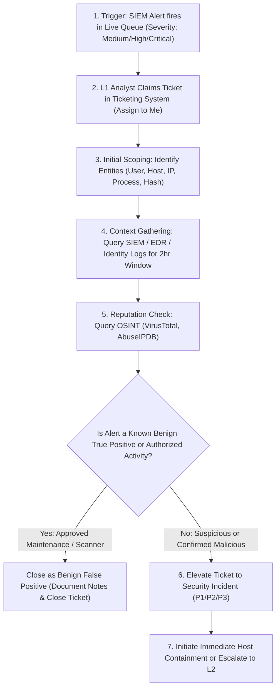

# 01. Alert Ingestion and Queue Triage SOP

[⬅️ Back to Workflows](./README.md) | [Next: Incident Investigation ➡️](./02_End_to_End_Incident_Investigation_Workflow.md)

---

### 1. Workflow Architecture Diagram

---

### 2. Standard 8-Point Operational Breakdown

#### 1. Trigger
- An automated detection rule or machine learning anomaly triggers in the SIEM (Microsoft Sentinel, Splunk) or EDR console (CrowdStrike, Defender) and appears in the real-time operational incident queue.

#### 2. Responsible Parties (RACI Matrix)
- **Accountable**: SOC Shift Lead.
- **Responsible**: SOC Tier 1 (L1) Triage Analyst.
- **Consulted**: Tier 2 (L2) Senior Analyst on-shift.
- **Informed**: SOC Incident Queue.

#### 3. Required Tools & Information
- **Tools**: SIEM Incident Dashboard, Ticketing System (ServiceNow SecOps / Jira), OSINT portals (VirusTotal, AbuseIPDB, URLScan), Identity Provider (Entra ID / Active Directory).
- **Inputs**: Alert Title, Timestamp, Severity, Impacted Entity (Username, Hostname, Internal IP), Indicator (External IP, URL, File Hash, Process Command Line).

#### 4. Step-by-Step Execution Procedure
1. **Claiming the Alert (0-3 minutes)**:
   - Analyst assigns the incident ticket to themselves in the ticketing portal to prevent duplicate triage by peers.
   - Target SLA for claiming: $\le 5$ minutes for High/Critical; $\le 15$ minutes for Medium.
2. **Entity Identification & Extraction (3-7 minutes)**:
   - Extract the primary target host (`HOST-W10-094`), target user (`alice.smith@contoso.com`), and suspicious indicator (`hash: 4a2b9...`, `IP: 185.220.101.5`).
3. **Historical Baseline & Context Gathering (7-12 minutes)**:
   - Query SIEM for host activity 1 hour before and 1 hour after the alert timestamp:
     - *Has this host or user triggered other alerts recently?*
     - *Is this host an executive workstation, a domain controller, or a test machine?*
4. **Reputation Triage (12-15 minutes)**:
   - Query VirusTotal for file hash: check detection ratio and community comments.
   - Query AbuseIPDB for external IP: check confidence of abuse score and country of origin.
   - Check IT change management schedule: *Is there an authorized vulnerability scan or penetration test occurring right now?*
5. **Disposition Determination**:
   - Classify as **False Positive (FP)**, **Benign Positive (BP)**, or **True Positive (TP)**.

#### 5. Decision Points & Logic Gates
- **IF** the alert was caused by authorized IT maintenance or an approved vulnerability scan, **THEN** tag as Benign False Positive, link the change ticket, and close.
- **IF** the file hash has $\ge 5$ AV detections on VirusTotal or command line shows encoded PowerShell downloading an external payload, **THEN** immediately declare a **Confirmed True Positive Incident**.
- **IF** evidence is inconclusive within 20 minutes, **THEN** escalate to Tier 2 for deep-dive analysis.

#### 6. Escalation Matrix
- **Critical Asset Impacted (Domain Controller, SWIFT Banking Server)**: Escalate to L2 / Incident Commander within 10 minutes.
- **Active Ransomware Indicators (Volume file renames)**: Initiate immediate host network isolation via EDR and call L2 Incident Lead.

#### 7. Expected Outcome
- The alert is definitively categorized within 15–20 minutes, eliminating queue backlog, filtering benign noise, and accelerating valid threat containment.

#### 8. Documentation & Audit Evidence
- Incident ticket notes documenting:
  - Exact triage steps performed.
  - VirusTotal/AbuseIPDB reputation query links.
  - Reason for closure (if FP) or escalation justification (if TP).
