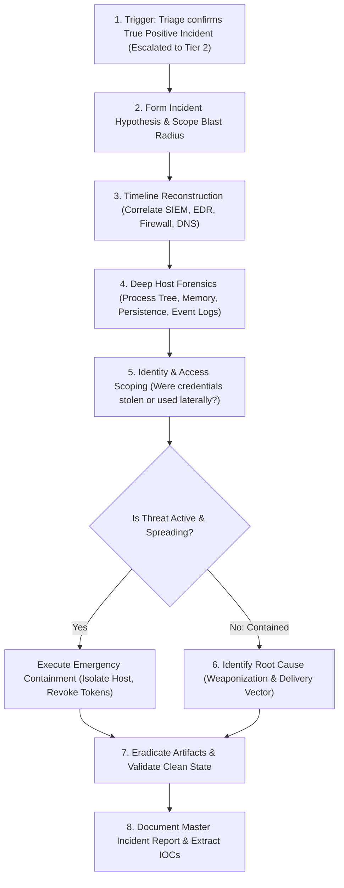

# 02. End-to-End Security Incident Investigation SOP

[⬅️ Prev: Queue Triage](./01_Alert_Ingestion_and_Queue_Triage.md) | [Back to Workflows](./README.md) | [Next: False Positive Tuning ➡️](./03_False_Positive_Identification_and_Tuning.md)

---

### 1. Workflow Architecture Diagram



---

### 2. Standard 8-Point Operational Breakdown

#### 1. Trigger
- An alert is confirmed as a True Positive security incident by Tier 1 triage, or an external notification is received from a national CERT or threat intelligence partner.

#### 2. Responsible Parties (RACI Matrix)
- **Accountable**: Incident Response (IR) Lead.
- **Responsible**: SOC Tier 2 (L2) Incident Responder.
- **Consulted**: Threat Intelligence Specialist, System Owner, Network Administrator.
- **Informed**: CISO, Legal Counsel, Affected Department Manager.

#### 3. Required Tools & Information
- **Tools**: EDR Console (Live Response), SIEM (Sentinel / Splunk), Network Forensics (Wireshark / Zeek), Identity Provider (Entra ID), Memory Analysis (Volatility).
- **Inputs**: Initial alert details, compromised hostname, user accounts involved, relevant IOCs.

#### 4. Step-by-Step Execution Procedure
1. **Scope the Blast Radius (First 30 minutes)**:
   - Search the SIEM for all occurrences of the malicious IP, domain, or file hash across the entire enterprise network over the last 30 days:
     ```kql
     DeviceNetworkEvents
     | where RemoteIP == "198.51.100.22" or RemoteUrl contains "evil-c2.com"
     | summarize by DeviceName, InitiatingProcessFileName, RemoteIP
     ```
   - Determine how many endpoints and user accounts have touched this indicator.
2. **Timeline Reconstruction**:
   - Establish the exact chronological timeline:
     - $T_0$: Initial delivery (Phishing email received).
     - $T_1$: User execution (Macro enabled in Word).
     - $T_2$: Child process spawned (`powershell.exe`).
     - $T_3$: C2 connection established (`outbound TCP 443`).
     - $T_4$: Lateral movement attempt (`SMB connection to File Server`).
3. **Endpoint Memory & Persistence Forensics**:
   - Access the host via EDR Live Response:
     - Inspect scheduled tasks (`schtasks /query /fo LIST /v`).
     - Inspect startup registry keys (`HKLM\Software\Microsoft\Windows\CurrentVersion\Run`).
     - Check for unauthorized local accounts (`net user`).
4. **Identity Scoping**:
   - Check if the compromised user account was used to authenticate to other servers or cloud portals within the window.
5. **Identify Root Cause**:
   - Pinpoint the exact vulnerability or mechanism that allowed the initial intrusion (e.g., missing patch, unauthenticated external service, phishing email).

#### 5. Decision Points & Logic Gates
- **IF** lateral movement to more than 3 hosts is discovered, **THEN** declare a **Major Security Incident (Sev-1)** and assemble the full Incident Management Team (IMT).
- **IF** ransomware encryption routines are observed, **THEN** immediately isolate all hosts in the same subnet to prevent network-wide propagation.

#### 6. Escalation Matrix
- **Ransomware / Mass Data Exfiltration**: Escalate to CISO, VP of IT, and Corporate Legal immediately (SLA: 15 minutes).

#### 7. Expected Outcome
- Complete comprehension of the attacker's trajectory, identification of all compromised hosts and accounts, complete containment, and zero remaining persistence mechanisms.

#### 8. Documentation & Audit Evidence
- Master Forensic Timeline document, full memory dump hashes, network PCAP captures, and signed Incident Closure Report.
