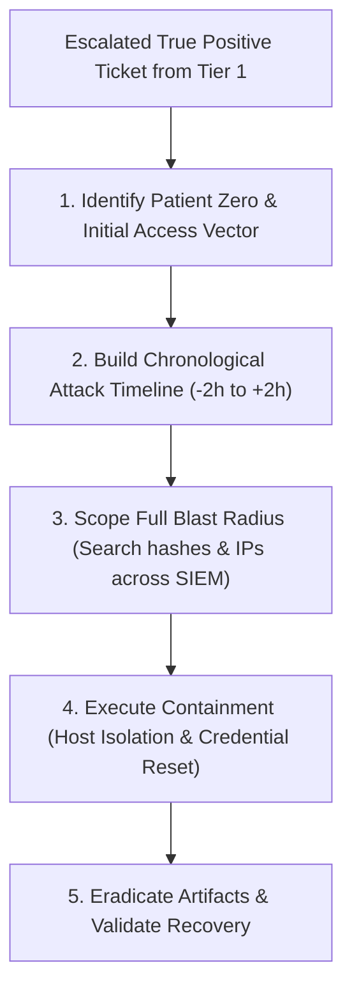

# 02. End-to-End Incident Investigation Workflow SOP

[⬅️ Prev: Alert Ingestion and Queue Triage](./01_Alert_Ingestion_and_Queue_Triage.md) | [Back to Workflows](./README.md) | [Next: False Positive Identification ➡️](./03_False_Positive_Identification_and_Tuning.md)

---

### 🎓 Beginner's Compass: Decoded Tools in This SOP
- **Root Cause Analysis (RCA)**: Pinpointing the exact initial method the attacker used to enter the company (e.g., unpatched VPN vulnerability, phishing email).
- **Blast Radius**: The full extent of compromised machines, user accounts, and data stores affected by the attack.
- **Timeline Reconstruction**: Building a chronological, minute-by-minute narrative of everything the attacker did from first entry to detection.

---

### 1. Plain-English Walkthrough: The Detective's Investigation

When an alert is confirmed as a real attack, the Tier 2 investigator acts like a homicide detective:
1. **The Crime Scene**: Which computer was infected first (**Patient Zero**)?
2. **The Entry Vector**: How did they get inside? (Did they click an email link? Exploit an open port?).
3. **Lateral Movement**: Where did they go next? (Did they jump from the receptionist's laptop to the financial database?).
4. **Data Impact**: Did they steal files or stage ransomware?



---

### 2. The 8-Point Operational SOP

#### 1. Trigger
Tier 1 analyst escalates a verified high-severity True Positive incident to Tier 2.

#### 2. Responsible Parties (RACI)
* **Responsible (R)**: Tier 2 Incident Responder (lead investigator).
* **Accountable (A)**: Incident Response Commander / SOC Manager.
* **Consulted (C)**: Threat Intelligence Analyst, Identity/Cloud Architects.
* **Informed (I)**: Legal Counsel, PR/Communications (if external breach).

#### 3. Required Tools & Inputs
* **SIEM**: Microsoft Sentinel / Splunk (for cross-log correlation).
* **EDR Console**: Live Response / Real-Time Response for file and memory retrieval.
* **Network Logs**: Firewall traffic, DNS logs, proxy logs.
* **Identity Logs**: Microsoft Entra ID / Okta sign-in and audit logs.

#### 4. Step-by-Step Procedure
1. **Establish War Room**: Open an emergency incident bridge call (Teams / Slack #incident-room).
2. **Identify Patient Zero**: Review the earliest timestamp of malicious activity on the affected host.
3. **Reconstruct Process Execution**:
   * Inspect process parent-child tree: What program launched the malicious binary?
   * Inspect web browser history and email logs for the 60 minutes preceding execution.
4. **Search Enterprise-Wide for IOCs**:
   * Query the SIEM for the malicious file hash across all 10,000 corporate computers:
     ```kusto
     DeviceFileEvents | where SHA256 == "known_bad_hash"
     ```
   * Query firewall logs for any other machines communicating with the attacker's C2 IP address.
5. **Formulate Containment Strategy**: Coordinate with IR Commander to isolate all affected hosts simultaneously.

#### 5. Decisions & Logic Gates
* **IF** evidence shows attacker accessed Domain Administrator credentials OR touched multiple critical servers -> **Declare Major Security Incident (Sev-1)** and notify executive leadership.
* **IF** the activity is confirmed isolated to a single non-privileged workstation -> **Execute local containment and standard remediation**.

#### 6. Escalation Matrix
* If active data exfiltration or ransomware encryption is detected, escalate to CISO within **15 minutes**.

#### 7. Expected Outcome
Complete containment of the adversary, zero ongoing command-and-control communication, full timeline documented.

#### 8. Documentation & Evidence Recorded
Preserve forensic disk images, volatile memory dumps (`.dmp`), firewall PCAPs, and complete timeline in the incident ticket.

---

### 3. Recommended Next Steps
Learn how to tune noisy rules that flood analysts with benign alerts:
- [03. False Positive Identification and Tuning SOP ➡️](./03_False_Positive_Identification_and_Tuning.md)
