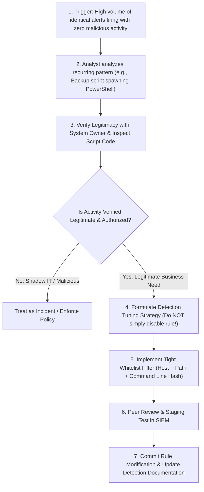

# 03. False Positive Identification and Detection Tuning SOP

[⬅️ Prev: Incident Investigation](./02_End_to_End_Incident_Investigation_Workflow.md) | [Back to Workflows](./README.md) | [Next: Containment & Recovery ➡️](./04_Incident_Containment_Eradication_and_Recovery.md)

---

### 1. Workflow Architecture Diagram

---

### 2. Standard 8-Point Operational Breakdown

#### 1. Trigger
- An analyst identifies that a specific SIEM or EDR rule has a False Positive (FP) rate exceeding 40%, generating repetitive alert fatigue.

#### 2. Responsible Parties (RACI Matrix)
- **Accountable**: SOC Detection Engineering Lead.
- **Responsible**: SOC Tier 2 Analyst / Detection Engineer.
- **Consulted**: Application / System Owner running the benign tool.
- **Informed**: Tier 1 Analysts (relieved of noisy alerts).

#### 3. Required Tools & Information
- **Tools**: SIEM Rule Editor, Git repository (Detection-as-Code / Sigma rules), EDR Console.
- **Inputs**: Alert Rule ID, Alerting Query, False Positive Event Samples, Justification from system owner.

#### 4. Step-by-Step Execution Procedure
1. **Data Sampling**: Collect at least 20 instances of the false positive alert across different dates and hosts.
2. **Identification of Benign Invariants**:
   - Determine what unique attributes identify this as legitimate business activity (e.g., Process is signed by Microsoft, executes from a protected path `C:\Program Files\EnterpriseBackup\`, runs under a dedicated service account `svc-backup`).
3. **Formulate Whitelist Logic (Avoid Overly Broad Exceptions!)**:
   - ❌ **BAD EXCLUSION**: `where CommandLine contains "powershell.exe"` (Completely blinds the rule to real attacks!).
   - ✅ **GOOD EXCLUSION**: `where ParentProcessName =~ "backup.exe" and AccountName =~ "svc-backup" and CommandLine contains "-MaintenanceJob"`
4. **Staging & Historical Testing**:
   - Test the modified query against the past 30 days of data in the SIEM to ensure it eliminates the benign noise while still triggering on simulated malicious samples.
5. **Peer Review & Deployment**:
   - Submit a Pull Request (PR) in the detection engineering Git repository.
   - Deploy the updated rule to production Sentinel/Splunk.

#### 5. Decision Points & Logic Gates
- **IF** an application owner asks to exclude an entire folder (e.g., exclude `C:\Temp\`), **THEN** REJECT the request. Attackers frequently place malware in unmonitored excluded folders.
- **IF** the vendor executable is unsigned and unverified, **THEN** require an official statement and file hash from the software vendor.

#### 6. Escalation Matrix
- **Disagreement with System Owner**: Escalate to SOC Manager and IT Architecture Review Board.

#### 7. Expected Outcome
- Elimination of repetitive alert noise without reducing defensive visibility, saving analyst triage hours and preventing critical alert fatigue.

#### 8. Documentation & Audit Evidence
- Git commit diff showing old rule vs new rule, testing results on 30-day historical data, and change ticket number.
