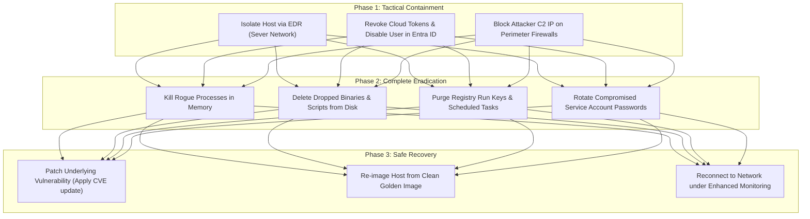

# 04. Incident Containment, Eradication, and Recovery SOP

[⬅️ Prev: False Positive Tuning](./03_False_Positive_Identification_and_Tuning.md) | [Back to Workflows](./README.md) | [Next: Escalation Matrix ➡️](./05_Escalation_Matrix_L1_to_L2_L3_and_IR.md)

---

### 🎓 Beginner's Compass: Decoded Acronyms & Terms
- **Containment**: Actions taken immediately to prevent an active attack from spreading laterally or stealing data.
- **Eradication**: Purging all traces of the attacker from the environment (deleting malware, removing persistence registry keys, terminating rogue accounts).
- **Recovery**: Restoring affected systems back into normal business production safely, verifying that the vulnerability has been patched.

---

### 1. Plain-English Walkthrough: Quarantine, Cure, and Return to Work

Think of managing an outbreak of an infectious virus in a hospital:
1. **Containment (Quarantine)**: Move the infected patient to an airtight isolation ward immediately so other patients don't breathe the same air.
2. **Eradication (Treatment)**: Administer medication to destroy the virus and sanitize the patient's room from top to bottom.
3. **Recovery (Discharge)**: Test the patient's blood to confirm zero viral load, vaccinate other patients, and allow them to return home safely.



---

### 2. The 8-Point Operational SOP

#### 1. Trigger
Tier 2 confirms a live infection or active unauthorized access in the enterprise.

#### 2. Responsible Parties (RACI)
* **Responsible (R)**: Tier 2 Incident Responder.
* **Accountable (A)**: Incident Commander.
* **Consulted (C)**: Systems Engineering, Identity Team.
* **Informed (I)**: Business Unit Manager.

#### 3. Required Tools & Inputs
* **EDR Console**: CrowdStrike Falcon / Microsoft Defender XDR.
* **IAM Console**: Microsoft Entra ID / Active Directory Domain Controller.
* **Firewall Console**: Palo Alto Panorama / Fortinet FortiManager.

#### 4. Step-by-Step Procedure
1. **Network Containment**: Navigate to EDR console > Select compromised machine > Click **Isolate Host**.
2. **Identity Lockdown**: Open PowerShell:
   ```powershell
   Update-MgUser -UserId "victim@contoso.com" -AccountEnabled $false
   Revoke-MgUserSignInSession -UserId "victim@contoso.com"
   ```
3. **Perimeter Block**: Add the attacker's C2 IP address and domain to the firewall's dynamic external blocklist.
4. **Eradicate Persistence**: Open EDR Live Response to inspect and purge scheduled tasks (`schtasks /delete`) and registry autostart keys.
5. **Re-imaging (Recovery)**: For severe malware infections (ransomware, rootkits), **never attempt to clean the OS manually**—wipe the machine and re-image from a clean, verified golden image!
6. **Enhanced Monitoring**: Place the user and host on the high-alert watchlist for **14 days** post-incident.

#### 5. Decisions & Logic Gates
* **IF** a machine was infected with commodity adware -> **Antivirus clean and reboot is sufficient**.
* **IF** a machine was infected with an advanced trojan (Cobalt Strike, Mimikatz, Ransomware) -> **Mandatory bare-metal wipe and re-image**.

#### 6. Escalation Matrix
* If containment actions impact business-critical production servers (e.g., shutting down the payroll database), obtain authorization from the Incident Commander or CISO.

#### 7. Expected Outcome
The threat actor is completely ejected from the environment with zero persistence hooks remaining.

#### 8. Documentation & Evidence Recorded
Record the exact timestamps of host isolation, credential revocation, and re-image completion in the incident summary.

---

### 3. Recommended Next Steps
Learn the escalation paths and communication protocols during security emergencies:
- [05. Escalation Matrix: L1 to L2, L3, and IR Deep Dive ➡️](./05_Escalation_Matrix_L1_to_L2_L3_and_IR.md)
