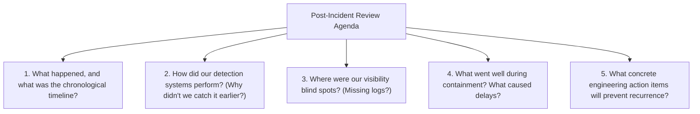

# 06. Post-Incident Review (PIR) and Documentation SOP

[⬅️ Prev: Escalation Matrix](./05_Escalation_Matrix_L1_to_L2_L3_and_IR.md) | [Back to Workflows](./README.md) | [Next: Real-World Scenarios Track ➡️](../06_Real_World_Scenarios/README.md)

---

### 1. The Purpose of the PIR
A security incident is not finished when the attacker is kicked out. An organization that fails to learn from an incident is guaranteed to suffer the exact same breach in the future.

The **Post-Incident Review (PIR)** (or "Post-Mortem") is a blameless, structured retrospective conducted within 3 to 5 business days following incident closure.

---

### 2. The 5 Core Questions of a Post-Mortem

---

### 3. Essential PIR Deliverables

1. **Executive Summary**: A non-technical 1-page briefing for the Board of Directors and CISO detailing business impact, customer data exposure, and total downtime.
2. **Technical Incident Report**: Detailed technical document containing full IOC tables, KQL hunting queries, ATT&CK TTP mappings, and firewall/EDR configurations.
3. **Corrective Action Plan (CAP)**: Jira tracking tickets assigned to IT, IAM, or DevSecOps teams (e.g., *"Patch all external VPN gateways within 7 days"*, *"Deploy EDR sensor to remaining 40 Linux servers"*).
