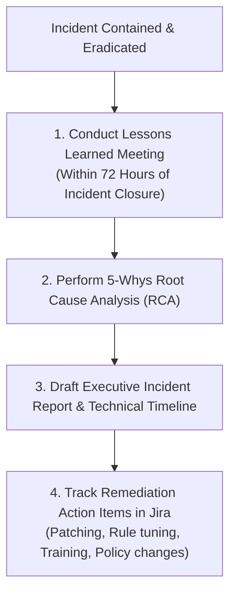

# 06. Post-Incident Review and Documentation SOP

[⬅️ Prev: Escalation Matrix](./05_Escalation_Matrix_L1_to_L2_L3_and_IR.md) | [Back to Workflows](./README.md) | [Next: Real-World Scenarios Track ➡️](../06_Real_World_Scenarios/README.md)

---

### 🎓 Beginner's Compass: Decoded Acronyms & Terms
- **Post-Incident Review (PIR)**: A formal post-mortem meeting held after an incident is resolved to examine what happened, what went well, and what failed.
- **RCA (Root Cause Analysis)**: Finding the fundamental weakness that allowed the breach to happen in the first place (e.g., *"Why did the employee have local admin rights?"*).
- **Lessons Learned**: Actionable engineering and policy changes implemented so the exact same attack can never succeed again.
- **Chain of Custody**: A legally binding paper trail documenting who collected, handled, and stored digital forensic evidence for court admissibility.

---

### 1. Plain-English Walkthrough: The Airplane Crash Investigation

When an airplane suffers an incident:
- Aviation investigators don't just tow the plane away and forget about it.
- The National Transportation Safety Board (NTSB) gathers the flight recorder (black box), analyzes the cockpit audio, and holds a detailed inquiry.
- They determine the exact mechanical flaw or pilot error and issue **mandatory safety directives** to all airlines globally so that specific disaster never happens again.
- In cybersecurity, the **Post-Incident Review** ensures that every security incident makes the company permanently stronger!



---

### 2. The "5 Whys" Root Cause Analysis Technique

To find the true root cause, never stop at the surface level:

```text
Problem: Production Database Server was encrypted with ransomware.
1. Why? The attacker logged in via Remote Desktop (RDP) from the internet.
2. Why? The firewall had Port 3389 open directly to the public web.
3. Why? A developer opened Port 3389 6 months ago to troubleshoot a bug from home.
4. Why? The developer was not aware of the corporate VPN policy.
5. Why? (ROOT CAUSE) The company lacks an automated firewall configuration audit tool and lacks mandatory cloud security training for developers!
```

---

### 3. Executive Incident Report Structure

When briefing the Chief Information Security Officer (CISO) and the Board of Directors:

1. **Executive Summary**: A non-technical paragraph explaining business impact: *"On November 21, 2026, an unauthorized third party gained access to one finance workstation via a phishing email. The SOC contained the incident within 18 minutes. Zero confidential customer records were extracted."*
2. **Key Operational Metrics**:
   * **MTTD**: 4 minutes.
   * **MTTR**: 18 minutes.
   * **Total Downtime**: 0 minutes.
3. **Attack Narrative & Visual Timeline**: A clean chronological sequence of events from initial access to host isolation.
4. **Remediation Action Items (Corrective Actions)**:
   * Item 1: Mandate FIDO2 hardware keys for all Finance employees (Owner: IAM Team, Target Date: Dec 15).
   * Item 2: Block macro execution on all downloaded Office files via GPO (Owner: Endpoint Team, Target Date: Dec 1).

---

### 4. Recommended Next Steps
Now that you have mastered all SOC concepts, technologies, and operational standard operating procedures, apply your knowledge to realistic breach scenarios:
- [06. Real-World Scenarios Track ➡️](../06_Real_World_Scenarios/README.md)
