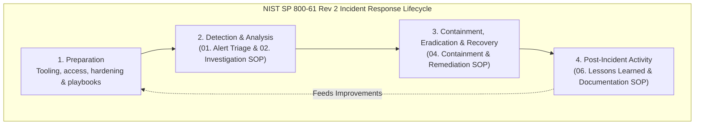

# 05. SOC Operational Workflows and Standard Operating Procedures (SOPs)

In cybersecurity operations, knowing the theory of malware or SIEM is useless without knowing **how to execute operational standard operating procedures** under strict incident response time limits.

Every SOP in this module follows the **Enterprise 8-Point Operational Framework**:
1. **Trigger**: What event or alert initiates this workflow?
2. **Responsible Parties (RACI)**: Who executes, approves, and oversees the procedure?
3. **Required Tools & Inputs**: What software, consoles, and telemetry are required?
4. **Step-by-Step Procedure**: Sequential operational actions executed by the analyst.
5. **Decisions & Logic Gates**: Explicit IF/THEN conditional decision criteria.
6. **Escalation Matrix**: Clear escalation thresholds, SLAs, and emergency call trees.
7. **Expected Outcomes**: What does "done" look like?
8. **Documentation & Evidence Retention**: What forensic records must be preserved for auditors and legal teams?

---

### 🗺️ The Standard Incident Response Lifecycle (NIST SP 800-61 Rev 2)

---

### 📚 Standard Operating Procedures in This Module

| SOP | Primary Focus | Target SLA |
| :--- | :--- | :--- |
| **[01. Alert Ingestion and Queue Triage](./01_Alert_Ingestion_and_Queue_Triage.md)** | Initial intake, priority classification, and FP vs TP sorting | 5 - 15 minutes |
| **[02. End-to-End Investigation](./02_End_to_End_Incident_Investigation_Workflow.md)** | Deep scoping, timeline reconstruction, and root cause analysis | 30 - 120 minutes |
| **[03. False Positive Identification](./03_False_Positive_Identification_and_Tuning.md)** | Distinguishing benign business noise and submitting rule tuning | Same shift |
| **[04. Containment, Eradication & Recovery](./04_Incident_Containment_Eradication_and_Recovery.md)** | Host isolation, token revocation, malware purge, and safe restore | P1: < 30 mins |
| **[05. Escalation Matrix](./05_Escalation_Matrix_L1_to_L2_L3_and_IR.md)** | Hand-off criteria from L1 to L2, L3, IR leads, and management | Instant upon trigger |
| **[06. Post-Incident Review](./06_Post_Incident_Review_and_Documentation.md)** | Root cause analysis (RCA), lessons learned, and executive reporting | Within 72 hours |
