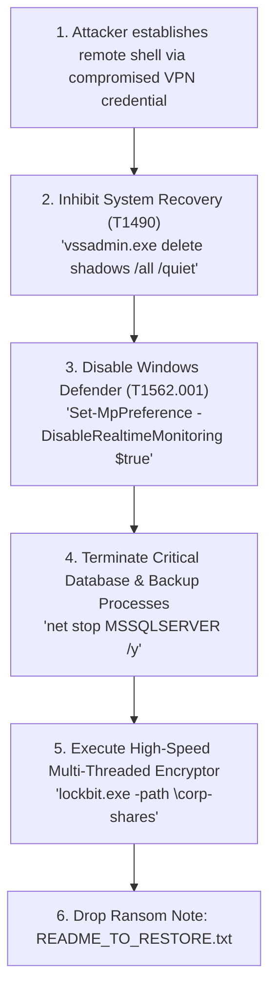

# Case Study 03: Ransomware Deployment Attempt (LockBit Playbook)

[⬅️ Prev: Impossible Travel](./02_Scenario_Suspicious_Impossible_Travel_Login.md) | [Back to Scenarios](./README.md) | [Next: Pass-the-Hash ➡️](./04_Scenario_Internal_Brute_Force_and_Pass_The_Hash.md)

---

### 1. Alert Context & Attack Chain
At 02:22 AM on Saturday, the EDR console triggers a Critical Incident:
`Inhibit System Recovery: Volume Shadow Copy Deletion attempt on Core File Server FS-CORP-01`

---

### 2. High-Fidelity Forensic Indicators (IOCs)

| Technique | Command Line Observed | MITRE ATT&CK Mapping |
| :--- | :--- | :--- |
| **Shadow Copy Deletion** | `vssadmin.exe delete shadows /all /quiet` | T1490 (Inhibit System Recovery) |
| **BCD Boot Tampering** | `bcdedit /set {default} bootstatuspolicy ignoreallfailures` | T1490 (Inhibit System Recovery) |
| **Disabling Security** | `powershell.exe Set-MpPreference -DisableRealtimeMonitoring $true` | T1562.001 (Impair Defenses) |
| **Stopping Services** | `net stop VeeamBackupSvc /y` | T1489 (Service Stop) |

---

### 3. Immediate 15-Minute Containment Playbook

1. **Instant Network Isolation**: Click **Isolate Host** in EDR console within 60 seconds of alert generation.
2. **Process Tree Termination**: EDR agent terminates the parent process spawning `vssadmin`.
3. **Verify Backup Storage Immutability**:
   - Check the offline / air-gapped backup repository (Veeam Hardened Repository / AWS S3 Object Lock with WORM - Write Once Read Many).
   - Ensure the ransomware was unable to delete or encrypt immutable backup snapshots.
4. **Subnet-Wide Containment**:
   - Push emergency firewall rule temporarily blocking internal SMB (TCP 445) across server subnets to prevent lateral encryption spreading.
