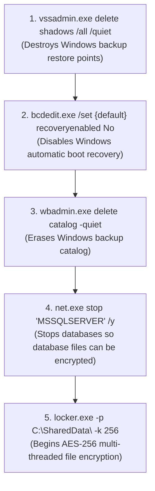

# 03. Scenario: Ransomware Deployment Attempt

[⬅️ Prev: Impossible Travel Login](./02_Scenario_Suspicious_Impossible_Travel_Login.md) | [Back to Scenarios](./README.md) | [Next: Internal Pass-The-Hash ➡️](./04_Scenario_Internal_Brute_Force_and_Pass_The_Hash.md)

---

### 🚨 The Incident Briefing
* **Timestamp**: Saturday, 02:45:00 UTC
* **Affected Asset**: `SRV-FILE-01` (Enterprise File Server holding 40TB of company data)
* **Initial Alert**: CrowdStrike Falcon Alert: *"High-Confidence Ransomware Staging Behavior - Volume Shadow Copy Deletion Detected"* (Severity: **P1 - CRITICAL**)

---

### 1. Step-by-Step Investigation Walkthrough

#### Step 1: Immediate Emergency Escalation
This is a **P1 Critical Emergency**. The L1 analyst instantly joins the emergency bridge line, alerts the on-duty Incident Commander, and verifies host isolation.

#### Step 2: Analyze the EDR Detection Chain
The EDR command-line history displays the classic pre-encryption staging sequence:

#### Step 3: Identify the Threat Actor Family
The extension `.blackcat` is appended to 12 files before EDR intervention. A text file appears in `C:\`: `README_RESTORE_BLACKCAT.txt`.  
**Threat Actor Identified**: **ALPHV / BlackCat Ransomware**.

---

### 2. Immediate Containment Actions Taken

1. **Automated EDR Network Quarantine**: CrowdStrike sensor terminates the `locker.exe` process tree and places `SRV-FILE-01` into Network Containment within **4 seconds** of the `vssadmin` command.
2. **Disable Compromised Service Account**: The attacker executed the commands using compromised service account `svc-filesync`. The account is immediately disabled across Active Directory.
3. **Sever Network Shares**: File share ports (SMB 445) are administratively disabled on internal switch VLANs to prevent lateral propagation.

---

### 3. Recovery and Lessons Learned
* **Impact**: Only 12 non-critical files were encrypted before automated EDR containment halted the attack.
* **Recovery**: The 12 encrypted files are restored from **air-gapped, immutable offline backups** taken at midnight.
* **Root Cause**: The service account `svc-filesync` had excessive local administrator rights and used a weak 10-character password.
* **Remediation**: Migrate all service accounts to **Group Managed Service Accounts (gMSA)** with 128-character auto-rotated passwords.
