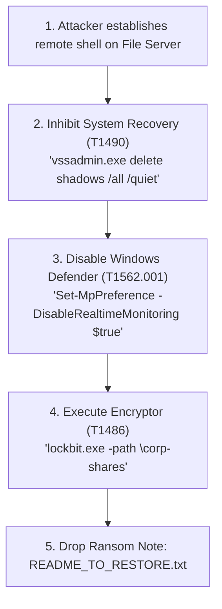

# Case Study 03: Ransomware Deployment Attempt (LockBit TTPs)

[⬅️ Prev: Impossible Travel](./02_Scenario_Suspicious_Impossible_Travel_Login.md) | [Back to Scenarios](./README.md) | [Next: Pass-the-Hash ➡️](./04_Scenario_Internal_Brute_Force_and_Pass_The_Hash.md)

---

### 1. Alert Trigger
EDR fires a Critical Alert on a File Server:
`vssadmin.exe delete shadows /all /quiet executed by svchost.exe`

### 2. The Attacker's Playbook

### 3. Rapid Emergency Response
1. **Immediate Host Isolation**: Network isolation triggered via EDR in < 30 seconds.
2. **Process Kill**: EDR automatically kills the parent process tree.
3. **Backup Protection**: Check backup storage server immediately; verify immutability (WORM storage).
4. **Subnet Containment**: Temporarily block SMB (TCP 445) across internal workstation-to-workstation segments to prevent worm-like spreading.
