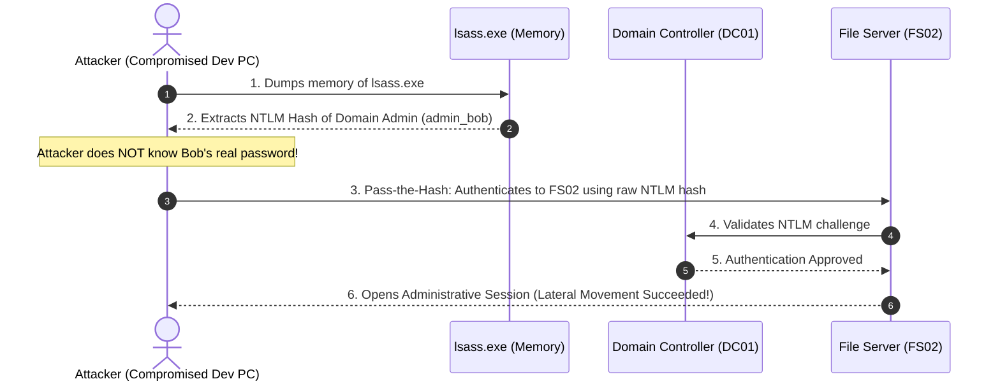

# 04. Scenario: Internal Brute Force and Pass-The-Hash

[⬅️ Prev: Ransomware Deployment](./03_Scenario_Ransomware_Deployment_Attempt.md) | [Back to Scenarios](./README.md) | [Next: DNS Data Exfiltration ➡️](./05_Scenario_DNS_Exfiltration_and_Beaconing.md)

---

### 🚨 The Incident Briefing
* **Timestamp**: Thursday, 14:10:00 UTC
* **Affected Asset**: `WKSTN-DEV-08` (Software Developer Machine)
* **Initial Alert**: Splunk ES Notable: *"Excessive Internal SMB Connections & NTLM Pass-the-Hash Signature"* (Severity: **High**)

---

### 1. Step-by-Step Investigation Walkthrough

#### Step 1: Query Internal Network Connections
The analyst runs an SPL search to see which internal machines `WKSTN-DEV-08` is contacting:

```spl
index=network sourcetype=pan:traffic src_ip="10.10.5.8" dest_port=445
| stats count by dest_ip, action
| sort - count
```

**The Finding**: A single developer machine attempted SMB connections to **142 internal servers and workstations** in 10 minutes!

#### Step 2: Inspect Endpoint LSASS Access
Querying Sysmon logs for `WKSTN-DEV-08`:
```spl
index=windows EventCode=10 TargetImage="C:\\Windows\\System32\\lsass.exe"
| table _time, SourceImage, GrantedAccess, CallTrace
```
* **Event Detected**: `SourceImage: C:\Users\Dev\AppData\Local\Temp\rundll.exe` requested access `0x1010` to `lsass.exe`.
* **The Technique**: **`T1003.001 (OS Credential Dumping)`** using Mimikatz or ProcDump to steal the NTLM password hash of a visiting Domain Administrator!



---

### 2. Immediate Containment Actions Taken

1. **Host Isolation**: Isolate `WKSTN-DEV-08` and `FS02` immediately.
2. **Reset Tier-0 Domain Credentials**: The compromised administrator (`admin_bob`) has their Active Directory password reset twice, and the **`krbtgt` domain password is reset** to invalidate any forged Kerberos tickets.
3. **Block NTLM**: Enable **Protected Users Security Group** in Active Directory, which disables NTLM authentication and forces Kerberos.

---

### 3. Root Cause and Lessons Learned
* **Root Cause**: A Domain Administrator logged into a standard workstation to troubleshoot a printer bug, leaving their high-privilege credentials cached in workstation RAM.
* **Remediation**: Enforce **Tiered Administrative Architecture (Active Directory Red Forest / ESAE model)**: Tier-0 Domain Admins are strictly prohibited from logging into Tier-2 workstations.
