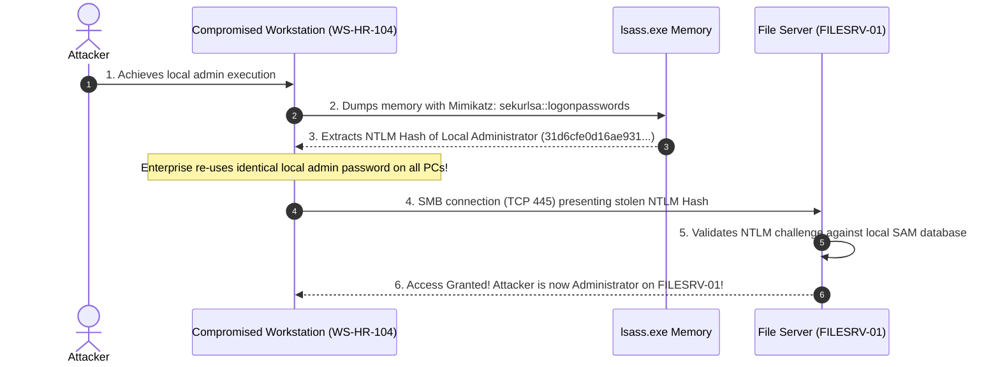

# Case Study 04: Internal Brute-Force and Pass-the-Hash Lateral Movement

[⬅️ Prev: Ransomware Attempt](./03_Scenario_Ransomware_Deployment_Attempt.md) | [Back to Scenarios](./README.md) | [Next: DNS Exfiltration ➡️](./05_Scenario_DNS_Exfiltration_and_Beaconing.md)

---

### 1. Alert Context & Initial Detection
At 03:14 AM on a Sunday, the SIEM triggers a High-Severity incident:
`Mass Windows Logon Failures followed by Successful NTLM Authentication across Multiple Internal Servers`
- **Source Host**: `WS-HR-104` (Internal IP: `10.10.4.52`)
- **Target Hosts**: 45 internal servers across subnet `10.10.10.0/24`
- **Event ID**: 4,200 instances of Event ID 4625 within 4 minutes, followed by successful Event ID 4624 (Logon Type 3: Network) on `FILESRV-01` and `SQLPROD-02`.

---

### 2. Technical Mechanism: Pass-the-Hash (MITRE ATT&CK T1550.002)



---

### 3. Forensic Investigation Queries

#### KQL Query in Microsoft Sentinel:
```kql
// Trace lateral movement logins originating from the compromised host
SecurityEvent
| where TimeGenerated > ago(6h)
| where IpAddress == "10.10.4.52"
| where EventID in (4624, 4625)
| project TimeGenerated, Computer, TargetUserName, EventID, LogonType, AuthenticationPackageName
| order by TimeGenerated asc
```

---

### 4. Remediation and Enterprise Hardening

1. **Immediate Host Isolation**: Isolate `WS-HR-104` via EDR to sever active lateral movement channels.
2. **Deploy Microsoft LAPS (Local Administrator Password Solution)**:
   - Eliminates static shared passwords.
   - Automatically generates a unique, cryptographically random 24-character password for every machine's local administrator account.
   - Rotates passwords automatically in Active Directory.
3. **Restructure Firewall Network Segmentation**:
   - Enforce host-based firewall rules blocking all inbound SMB (TCP 445) and RDP (TCP 3389) traffic **between workstations**. Workstations should never communicate directly with other workstations.
