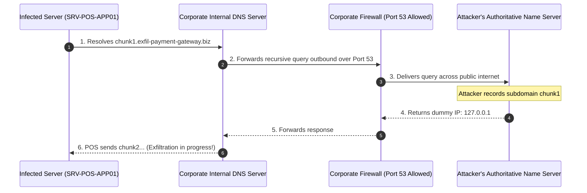

# 05. Scenario: DNS Data Exfiltration and C2 Beaconing

[⬅️ Prev: Internal Pass-The-Hash](./04_Scenario_Internal_Brute_Force_and_Pass_The_Hash.md) | [Back to Scenarios](./README.md) | [Next: Hands-On Labs Track ➡️](../07_Hands_On_Labs/README.md)

---

### 🚨 The Incident Briefing
* **Timestamp**: Friday, 22:15:00 UTC
* **Affected Asset**: `SRV-POS-APP01` (Point-of-Sale Payment Application Server)
* **Initial Alert**: Suricata IDS Alert: *"High-Entropy DNS Query Volume to Dynamic Subdomain - Suspected DNS Tunneling"* (Severity: **Critical**)

---

### 1. Step-by-Step Investigation Walkthrough

#### Step 1: Inspect DNS Server Query Logs
The analyst reviews recursive DNS query logs for `SRV-POS-APP01`:

```text
22:14:01 UTC | Query: a8f9c01824b.data.exfil-payment-gateway.biz | Type: TXT
22:14:02 UTC | Query: 91b4028fa10.data.exfil-payment-gateway.biz | Type: TXT
22:14:03 UTC | Query: 4429fa01948.data.exfil-payment-gateway.biz | Type: TXT
22:14:04 UTC | Query: 88ba049182a.data.exfil-payment-gateway.biz | Type: TXT
```

**The Pattern**:
* Over **4,000 unique DNS queries** generated in 10 minutes.
* All queries share the same base domain: `exfil-payment-gateway.biz`.
* Each query has an extraordinarily long, random, high-entropy subdomain prefix.

#### Step 2: How DNS Tunneling Works
Firewalls block direct outbound HTTP/FTP connections from sensitive servers, but **almost all firewalls permit outbound DNS (Port 53)** so servers can resolve IP addresses.
* The malware cuts stolen customer credit cards into small chunks: `4111222233334444`.
* It encodes the data into hex: `a8f9c01824b`.
* It requests to resolve `a8f9c01824b.data.exfil-payment-gateway.biz`.
* The query reaches the attacker's authoritative name server, where the attacker logs the incoming subdomain and reconstructs the stolen credit card records!



---

### 2. Immediate Containment Actions Taken

1. **DNS Sinkholing**: The security engineer updates internal DNS forwarders to redirect all queries for `exfil-payment-gateway.biz` to internal loopback (`127.0.0.1`), instantly killing exfiltration.
2. **Host Network Severance**: Isolate `SRV-POS-APP01` using EDR.
3. **Inspect POS Memory**: Run memory dump via Live Response; discover memory-scraping process (`pos_dump.exe`) reading unencrypted credit card data from RAM.

---

### 3. Root Cause and Lessons Learned
* **Root Cause**: The POS software was storing unencrypted track data in memory, violating PCI-DSS regulations.
* **Remediation**:
  * Implement Point-to-Point Encryption (P2PE) hardware on payment terminals.
  * Deploy **DNS Security Inspection / Response Policy Zones (RPZ)** that block high-entropy DNS queries and newly registered domains.
