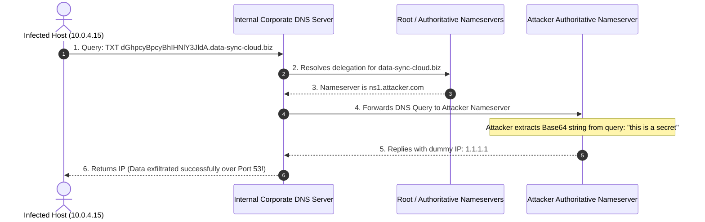

# Case Study 05: DNS Exfiltration and C2 Beaconing

[⬅️ Prev: Pass-the-Hash](./04_Scenario_Internal_Brute_Force_and_Pass_The_Hash.md) | [Back to Scenarios](./README.md) | [Next: Hands-On Labs Track ➡️](../07_Hands_On_Labs/README.md)

---

### 1. Detection via Network Analytics
Zeek/Corelight network sensors detect an anomaly: A single host is generating 20 DNS queries per minute to subdomains of `data-sync-cloud.biz`, with each subdomain containing high-entropy random characters:
- `dGhpcyBpcyBhIHNlY3JldA.data-sync-cloud.biz`
- `ZXhmaWx0cmF0aW9uIGRhdGE.data-sync-cloud.biz`

### 2. Defense and Remediation
- Configure DNS Firewalls / Umbrella to block dynamic non-business subdomains.
- Enforce strict packet inspection on UDP 53 to block DNS tunneling payloads exceeding standard character lengths.
