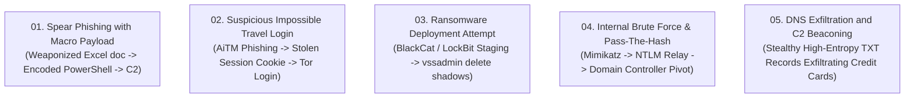

# 06. SOC Real-World Scenarios Track

In this module, theoretical concepts and standard operating procedures are put to the test in **realistic, hands-on enterprise breach scenarios**.

Each scenario simulates a real-world cybersecurity incident that an L1/L2 SOC Analyst encounters on duty, complete with **raw log artifacts, step-by-step triage actions, containment commands, and root-cause analysis**.

---

### 🗺️ Incident Case Studies

---

### 📚 Scenarios at a Glance

| Scenario | Primary Attack Vector | MITRE ATT&CK Tactic | Key Defensive Action |
| :--- | :--- | :--- | :--- |
| **[01. Spear Phishing Payload](./01_Scenario_Spear_Phishing_with_Malicious_Payload.md)** | Malicious email attachment | Initial Access (`TA0001`) & Execution (`TA0002`) | Host containment via EDR and email purging |
| **[02. Impossible Travel Login](./02_Scenario_Suspicious_Impossible_Travel_Login.md)** | Stolen OAuth token / session replay | Initial Access (`TA0001`) & Defense Evasion (`TA0005`) | Immediate token revocation and conditional access tuning |
| **[03. Ransomware Deployment](./03_Scenario_Ransomware_Deployment_Attempt.md)** | Shadow copy wipe & mass encryption | Impact (`TA0040`) | Rapid host network severance and immutable backup restore |
| **[04. Internal Pass-The-Hash](./04_Scenario_Internal_Brute_Force_and_Pass_The_Hash.md)** | NTLM hash theft & SMB propagation | Lateral Movement (`TA0008`) & Credential Access (`TA0006`) | Tier-0 Domain Admin credential reset & Kerberos enforce |
| **[05. DNS Data Exfiltration](./05_Scenario_DNS_Exfiltration_and_Beaconing.md)** | Tunneling confidential data over Port 53 | Exfiltration (`TA0010`) & C2 (`TA0011`) | DNS sinkholing and domain blocking at recursive resolver |
