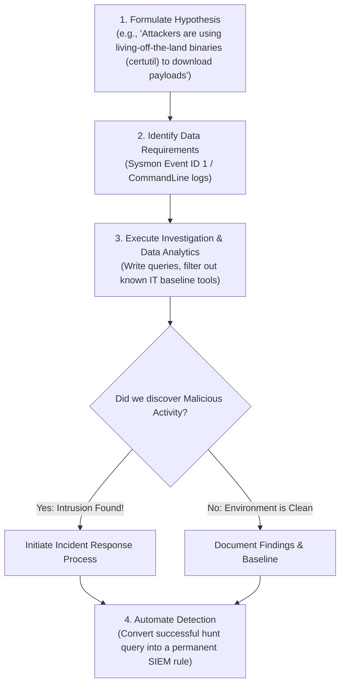

# 01. Proactive Threat Hunting Methodology

[⬅️ Back to Advanced Topics](./README.md) | [Next: Detection Engineering ➡️](./02_Detection_Engineering_and_Sigma_Rules.md)

---

### 1. Threat Hunting vs Alert Triage

- **Alert Triage (Reactive)**: Waiting for the SIEM or EDR bell to ring, then checking the alert.
- **Threat Hunting (Proactive)**: Starting with the assumption: *"An attacker is ALREADY inside our network right now, and no alarm has gone off. How do I find them?"*

---

### 2. The Hypothesis-Driven Threat Hunting Cycle

