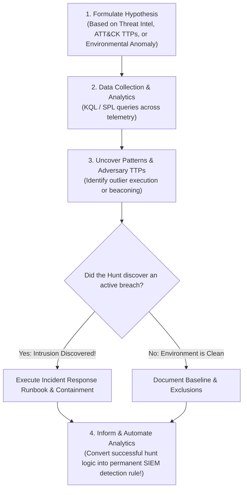

# 01. Proactive Threat Hunting Methodology Deep Dive

[⬅️ Back to Advanced Topics](./README.md) | [Next: Detection Engineering ➡️](./02_Detection_Engineering_and_Sigma_Rules.md)

---

### 1. What is Threat Hunting?

While front-line alert triage is **reactive** (waiting for the SIEM bell to ring), **Threat Hunting** is the **proactive, hypothesis-driven pursuit** of stealthy adversaries and advanced persistent threats (APTs) who have already breached the perimeter and bypassed automated defenses.

> 💡 **Analogy**: The Smoke Detector vs The Crime Detective:
> - **Alert Triage**: A smoke alarm sounds in the hallway. You rush to put out the kitchen fire.
> - **Threat Hunting**: No smoke alarm has sounded, but you notice a single window latch on the first floor is unlocked and a muddy footprint is on the rug. You methodically search every room in the house with a flashlight to locate the hidden burglar before they steal anything.

---

### 2. The Sqrrl Threat Hunting Framework



---

### 3. Practical Threat Hunting Models

#### Model A: Hypothesis-Driven (Intel-Based)
- **Source**: CISA releases a cybersecurity advisory stating APT28 is exploiting `certutil.exe` to download backdoors.
- **Hunt Hypothesis**: *"Threat actors are using living-off-the-land Windows binaries (certutil/bitsadmin) to bypass perimeter egress controls."*
- **Query Execution (KQL)**:
  ```kql
  DeviceProcessEvents
  | where TimeGenerated > ago(30d)
  | where FileName in~ ("certutil.exe", "bitsadmin.exe")
  | where ProcessCommandLine has_any ("-urlcache", "-split", "/transfer")
  | project TimeGenerated, DeviceName, AccountName, ProcessCommandLine, InitiatingProcessFileName
  ```

#### Model B: Outlier & Anomaly Detection (Frequency Analysis / Stacking)
- **Concept**: Attackers often blend in by using standard tools, but their execution frequency is statistically rare compared to normal corporate operations.
- **Hunting Technique**: Group all running processes across 10,000 corporate laptops, count occurrences, and inspect the **rarest 1% of executions**:
  ```kql
  DeviceProcessEvents
  | where TimeGenerated > ago(7d)
  | summarize HostCount = dcount(DeviceName) by FileName, FolderPath
  | where HostCount <= 2 // Running on only 1 or 2 machines in the entire company!
  | order by HostCount asc
  ```
